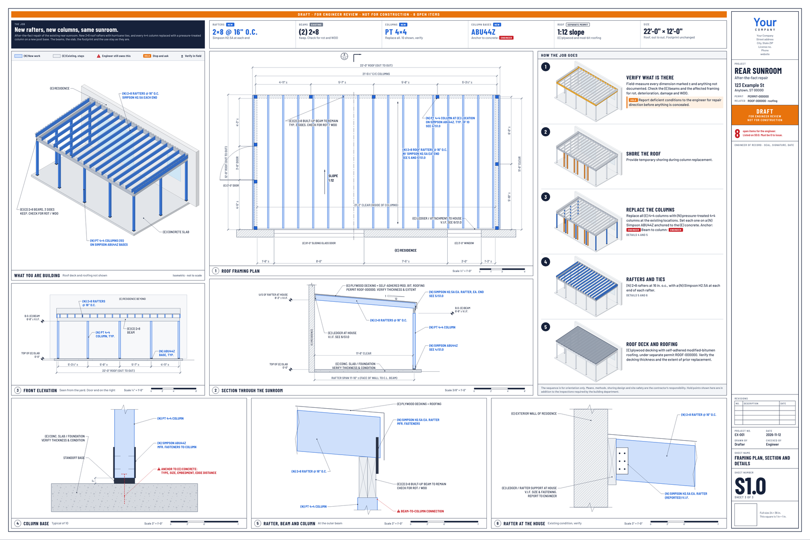

# Oasis-Blueprints

Engineering and construction drawings as HTML. No CAD, no DWG.

Building departments ask for a PDF, not a DWG. So the drawing can be a web page: one self-contained HTML
file per job, 24 × 36 in sheets, every view at a stated true scale, printed to PDF by any browser.
Oasis-Blueprints is an Agent Skill that makes Claude or ChatGPT draw that set from a described job, with
your own company and logo in the title block.



## What a set looks like

- **Cover** for the office and the plan reviewer: the job in one sentence, scope, notes, design criteria
  and the list of open items.
- **Field sheet** for the person building it: a picture of the finished job, numbered steps with a small
  picture each, a plan, a section and the connection details.
- **Colour is meaning**: blue is new work, grey is existing, red is waiting on the engineer, orange is a hold.

## The rule it is built around

**The model is the drafter, not the engineer.** It never supplies a member size, anchor, footing or load
on its own. Anything the user did not give becomes an open item, shows red on the sheets, is counted in
the title block, and blocks the set from being issued until the engineer of record answers it. The built
HTML has an **Edit** button for typing those answers, filling the title block and swapping the logo, then
**Print / Save as PDF**.

The kit draws and checks layout. It does not design or check structure, and a set is a draft until a
licensed engineer closes the open items and seals it.

## Examples

Built output is committed, so you can open it without installing anything.

| Example | Job type | Open it |
|---|---|---|
| Sunroom repair | `sunroom` (existing + new, imperial) | [`sheet-set.pdf`](examples/sheet-sets/sunroom-repair/sheet-set.pdf) · [`sheet-set.html`](examples/sheet-sets/sunroom-repair/sheet-set.html) · [`project.json`](examples/sheet-sets/sunroom-repair/project.json) |
| Freestanding deck | `deck` (all new, inches or millimetres) | [`sheet-set.pdf`](examples/sheet-sets/deck/sheet-set.pdf) · [`sheet-set.html`](examples/sheet-sets/deck/sheet-set.html) · [`project.json`](examples/sheet-sets/deck/project.json) |

## Use it

- **As a local Codex skill.** Copy `skills/oasis-blueprints` to `$CODEX_HOME/skills/oasis-blueprints`
  (or `~/.codex/skills/oasis-blueprints` when `CODEX_HOME` is unset), retaining its assets, scripts,
  references, and licenses. Invoke `$oasis-blueprints` with the project sources and requested sheets.
- **As a skill in Claude or ChatGPT.** Zip the folder (`cd skills && zip -r oasis-blueprints.zip oasis-blueprints`)
  and upload the zip where your app manages skills. Then ask for a drawing set and give it your job.
- **As a Claude plugin.** This repository is a plugin (`.claude-plugin/plugin.json`) that carries the skill.
- **By hand.** Python 3 standard library only:

  ```bash
  cd skills/oasis-blueprints
  python scripts/build.py assets/examples/deck/project.json deck.html
  python scripts/print.py deck.html deck.pdf --png preview-     # optional: needs Playwright + Chromium
  ```

Start with [`skills/oasis-blueprints/SKILL.md`](skills/oasis-blueprints/SKILL.md). A new kind of job is one
JavaScript file of about 150 lines: see
[`references/writing-views.md`](skills/oasis-blueprints/references/writing-views.md).

Supply `--brand my-brand.json` when you have a company file. PDF export needs Playwright and Chromium
in the Python environment used to run the script:

```bash
python -m pip install playwright
python -m playwright install chromium
python -m unittest discover -s tests -v
```

The tests exercise example exports, actual drawing scale in inches and millimetres, blank-criteria
issue checks, local paths containing reserved URL characters, and saving/reopening browser edits.
They validate drafting behavior, not structural adequacy or engineer approval.

## Repository layout

- `skills/oasis-blueprints/`: the drawing skill: workflow, drawing kit, job types, fonts, examples
- `examples/sheet-sets/`: example sheet sets built with it (project file, HTML, PDF, previews)
- `.claude-plugin/`: plugin manifest, so the repository installs as a Claude plugin
- `SPECIFICATION.md`, `library/`, `docs/`, `WindCalculations/`, `examples/*.json`: PCP, described below

## Also in this repository: PCP, the Project Context Protocol

PCP is an open, machine-readable protocol for defining how a project should run: one shared project
contract that humans and bots can both execute against. It is the planning side of the same idea, and
it lives here alongside the drawing skill.

<details>
<summary>Read the PCP overview</summary>

PCP standardizes:

- project type and execution model
- required deliverables
- required documents
- context libraries (engineering standards, QC checklists, policies)
- optimization rubrics (cycle time, quality, predictability, cost)
- bot/agent operating context
- Airtable mapping for operational use

### Why PCP

Most teams lose time because project context lives across docs, chat, and memory. PCP turns that context into a single protocol payload so work can be launched, audited, and automated consistently.

### Core concepts

- `project`: identity, type, goals, stage, roles
- `deliverables`: what must be produced and how completion is measured
- `documents_required`: mandatory artifacts to create/maintain
- `context_modules`: reusable policy and execution libraries
- `workflows`: stage gates and QC checks
- `agents`: bot responsibilities and boundaries
- `airtable`: mapping of PCP entities to Airtable tables/fields

### Quick start

1. Copy an example from `examples/`.
2. Validate your PCP file against `schema/pcp.schema.json`.
3. Reference reusable defaults from `library/`.
4. Map entities into Airtable using `airtable/field-mapping.md`.

### PCP files

- `SPECIFICATION.md`: protocol specification
- `schema/pcp.schema.json`: JSON Schema for PCP payloads
- `examples/`: complete sample PCP payloads
- `library/`: reusable project types, deliverables, docs, context modules
- `airtable/`: Airtable integration guidance
- `templates/`: document templates used by PCP payloads
- `docs/`: operational templates and reference docs
- `WindCalculations/`: standardized wind-calculation subcategory playbooks

### Standardized engineering intake matrix

For teams mapping project types to default deliverables, required documents, and execution resources:

- Canonical matrix: `library/taxonomy/project-delivery-matrix.json`
- Operational guidance: `docs/standardized-sop-framework.md`
- Example generated PCP payload: `examples/container-home-pcp.json`
- Container plans deliverable index: `docs/container-plans-deliverable.md`
- Plans-as-product strategy scaffold: `docs/plans-as-product-scaffold.md`

This gives you a machine-readable baseline for Airtable automations and bot task assignment.

Wind subcategory playbooks are available under `WindCalculations/` and mapped in `library/taxonomy/project-delivery-matrix.json`.

### Versioning

Protocol versioning uses semantic versioning in `pcp_version`.

- Major: breaking structural changes
- Minor: backward-compatible additions
- Patch: clarifications and non-breaking fixes

</details>

## Open source intent

This repository is designed as a shared public baseline for teams and autonomous systems. You can fork it, extend it, and propose upstream improvements. See `CONTRIBUTING.md` and `LICENSE`.
