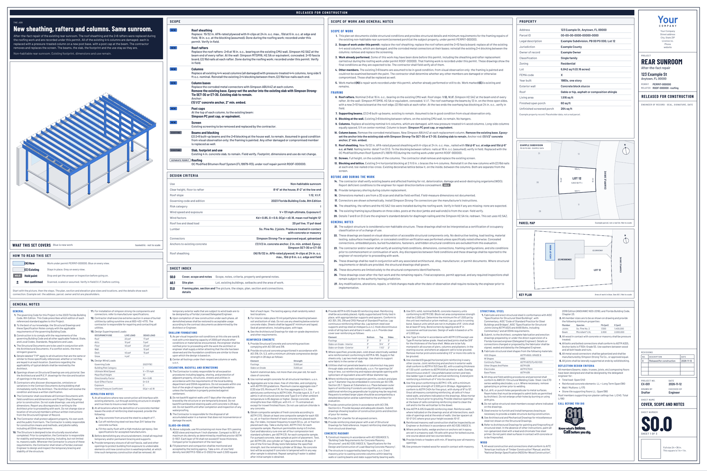
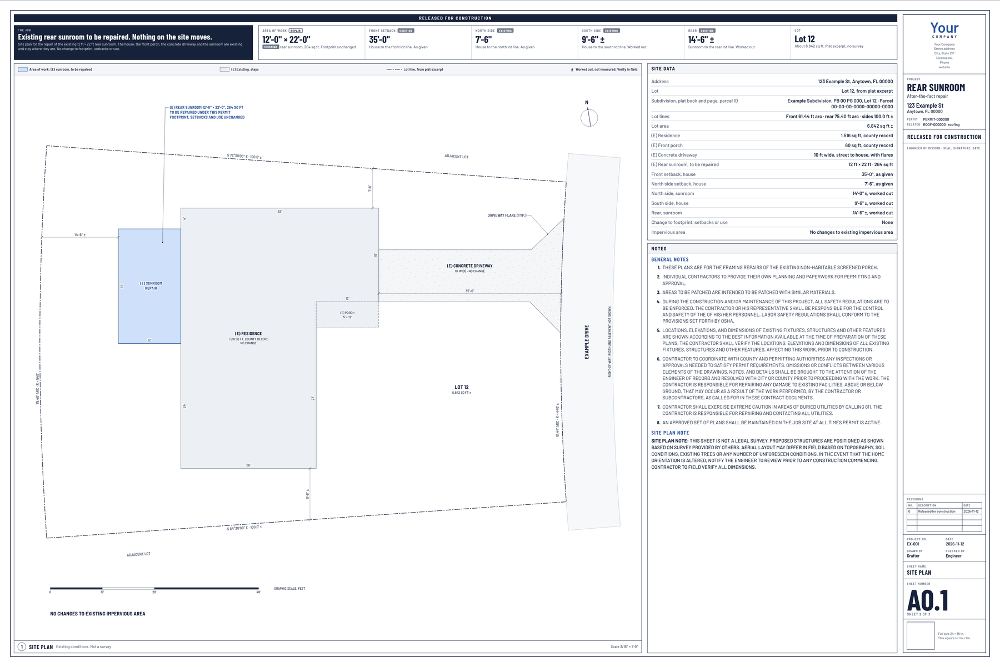
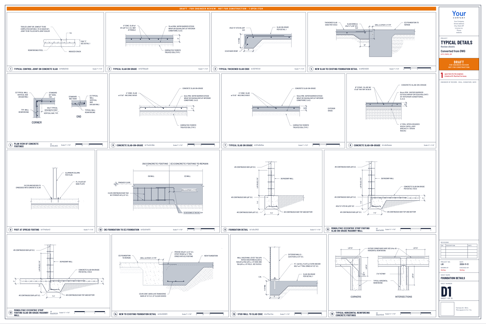

# Oasis-Blueprints

Engineering and construction drawings as HTML. No CAD, no DWG.

Building departments ask for a PDF, not a DWG. So the drawing can be a web page: one self-contained HTML
file per job, 24 × 36 in sheets, every view at a stated true scale, printed to PDF by any browser.
Oasis-Blueprints is an Agent Skill, packaged as a Claude plugin, that draws that set from a described job,
with your own company and logo in the title block.


## What a set looks like

- **Cover** for the office and the plan reviewer: the job in one sentence, scope, notes, design criteria
  and the list of open items.
- **Field sheet** for the person building it: a picture of the finished job, numbered steps with a small
  picture each, a plan, a section and the connection details.
- **Colour is meaning**: blue is new work, grey is existing, red is waiting on the engineer, orange is a hold.

## The rule it is built around

**The model is the drafter, not the engineer.** It never supplies a member size, anchor, footing or load
on its own. Anything the user did not give becomes an open item, shows red on the sheets, is counted in
the title block, and blocks the set from being issued until the engineer of record answers it. The built
HTML has an **Edit** button for typing those answers, filling the title block and swapping the logo, then
**Print / Save as PDF**.

The kit draws and checks layout. It does not design or check structure, and a set is a draft until a
licensed engineer closes the open items and seals it.

## Examples

Open the live sets in a browser. The project files that produced them are in `examples/sheet-sets/`.

- **Sunroom repair** is a finished set, released for construction, with three sheets: a cover (scope,
  design criteria, property record and general notes), a site plan, and a framing sheet with the plan,
  section and redrawn details. Its own drawing code, `sunroom.js`, sits beside its project file. Names,
  address, permit numbers and the lot are placeholders.
- **Freestanding deck** is a draft. It is the example that shows open items in red: the values the
  engineer still owes, counted in the title block and blocking the set from being issued.

| Example | Job type | Open it |
|---|---|---|
| Sunroom repair | `sunroom` (existing + new, imperial), 3 sheets, finished | [Live sheet set](https://oasisengineering.com/blueprints/examples/sunroom-repair/) · [PDF](https://oasisengineering.com/blueprints/examples/sunroom-repair/sheet-set.pdf) · [`project.json`](examples/sheet-sets/sunroom-repair/project.json) |
| Detail library | `library` (sheets of standard details only), 12 sheets | [`project.json`](examples/sheet-sets/detail-library/project.json) · [sheet pictures](library/details/typical/sheets/) |
| Freestanding deck | `deck` (all new, inches or millimeters), draft with open items | [Live sheet set](https://oasisengineering.com/blueprints/examples/deck/) · [PDF](https://oasisengineering.com/blueprints/examples/deck/sheet-set.pdf) · [`project.json`](examples/sheet-sets/deck/project.json) |





## Detail library

Standard construction details (slabs, footings, masonry walls, wood framing, roof framing) converted from
CAD into data, so the kit draws them on a sheet at true scale with the same pens and fonts as the rest of
the set. Each detail is one JSON file with an 8-character id. A collection is a folder under
`library/details/` with its own `index.json`; the first is `typical`, with 72 details. A project lists the
ids it needs on a sheet of type `details`.

**A library detail is the engineer's drawing, not the drafter's.** It goes on a set only when the engineer
of record says it applies, and nothing inside it (sizes, notes) is edited. The details in `typical` were
converted by machine and are marked "checked by the engineer: not yet" in its index until each has been
compared with its source.



The full list, with every sheet, is in [`library/details/README.md`](library/details/README.md).

## Use it

- **As a Claude plugin.** This repository is the plugin: `.claude-plugin/plugin.json` plus the skill in
  `skills/oasis-blueprints/`. Add it, then ask for a drawing set and describe the job.
- **As a skill.** Download the skill zip from [oasisengineering.com/blueprints](https://oasisengineering.com/blueprints/)
  and upload it where your assistant manages skills. The same folder loads in other assistants that
  support Agent Skills, including ChatGPT.
- **As a local Codex skill.** Copy `skills/oasis-blueprints` to `$CODEX_HOME/skills/oasis-blueprints`
  (or `~/.codex/skills/oasis-blueprints` when `CODEX_HOME` is unset), retaining its assets, scripts,
  references, and licenses. Invoke `$oasis-blueprints` with the project sources and requested sheets.
- **By hand.** Python 3 standard library only:

  ```bash
  cd skills/oasis-blueprints
  python scripts/build.py assets/examples/deck/project.json deck.html
  python scripts/print.py deck.html deck.pdf --png preview-     # optional: needs Playwright + Chromium
  ```

Start with [`skills/oasis-blueprints/SKILL.md`](skills/oasis-blueprints/SKILL.md). A new kind of job is one
JavaScript file of about 150 lines: see
[`references/writing-views.md`](skills/oasis-blueprints/references/writing-views.md).

Supply `--brand my-brand.json` when you have a company file. PDF export needs Playwright and Chromium
in the Python environment used to run the script:

```bash
python -m pip install playwright
python -m playwright install chromium
python -m unittest discover -s tests -v
```

The tests exercise example exports, actual drawing scale in inches and millimetres, blank-criteria
issue checks, local paths containing reserved URL characters, and saving/reopening browser edits.
They validate drafting behavior, not structural adequacy or engineer approval.

## What the plugin runs, sends and fetches

The skill runs two Python scripts that ship in this repository, on the machine where the assistant runs code:

- `scripts/build.py` reads your project file, your optional company file and logo, and the kit files that
  ship with the skill, and writes one HTML file. Python standard library only.
- `scripts/print.py` is optional. If Playwright and Chromium are already installed, it opens that HTML in
  headless Chromium to save the PDF, run the layout check and write preview images. It installs nothing.

It sends nothing and fetches nothing. There are no network calls, no credentials, no hooks, no MCP servers
and no telemetry. The bundled Barlow fonts (SIL Open Font License) are copied into the output HTML so a
sheet looks the same on every machine, and the output HTML makes no network requests either. The source
note in each built HTML is static text: its two links are followed only if a person clicks them.

A person stays in the loop by design: every set is a draft with its unanswered engineering questions
shown in red, and it cannot be marked as issued until a licensed engineer has answered each one.

## License and attribution

MIT License, Copyright (c) 2026 Oasis Engineering, LLC. It covers the skill, the kit, the examples and the
libraries. Anyone may fork it, change it and put their own company in the title block.

The license notice stays with any copy of the kit. Each kit file starts with it, so each built HTML carries
it. Each built HTML also has a source note in its head and one line at the foot of the Edit panel. None of
that prints, appears in the PDF or makes a request. Drawings made with the kit belong to whoever prepared
them.

## Repository layout

- `skills/oasis-blueprints/`: the drawing skill: workflow, drawing kit, job types, fonts, examples
- `examples/sheet-sets/`: the example jobs (project file, previews, and for the sunroom its own drawing code and
  cover figures); the built sets are linked above
- `.claude-plugin/`: plugin manifest and listing icon, so the repository installs as a Claude plugin

## Open source intent

This repository is designed as a shared public baseline for teams and autonomous systems. You can fork it, extend it, and propose upstream improvements through a pull request. See `LICENSE`.
