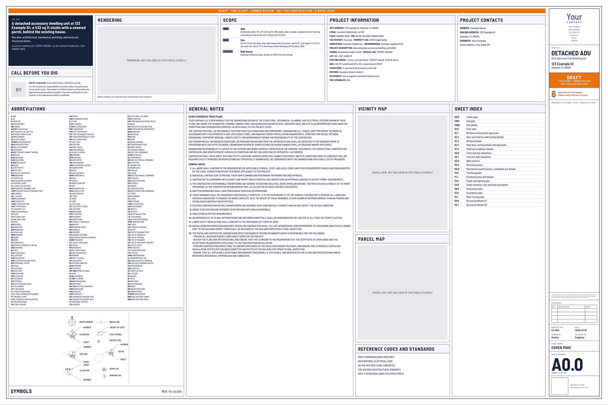
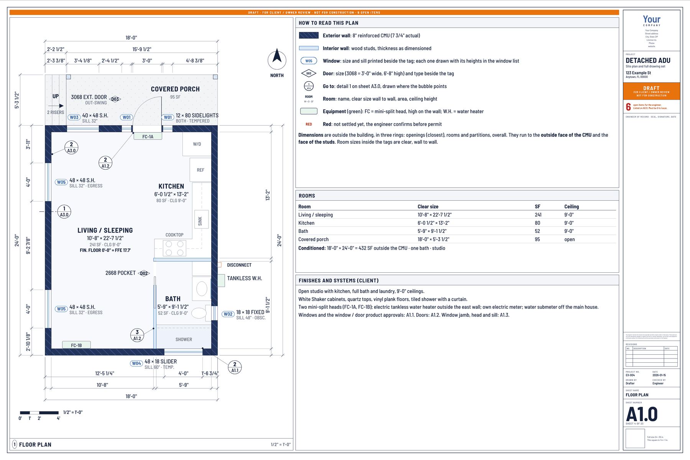
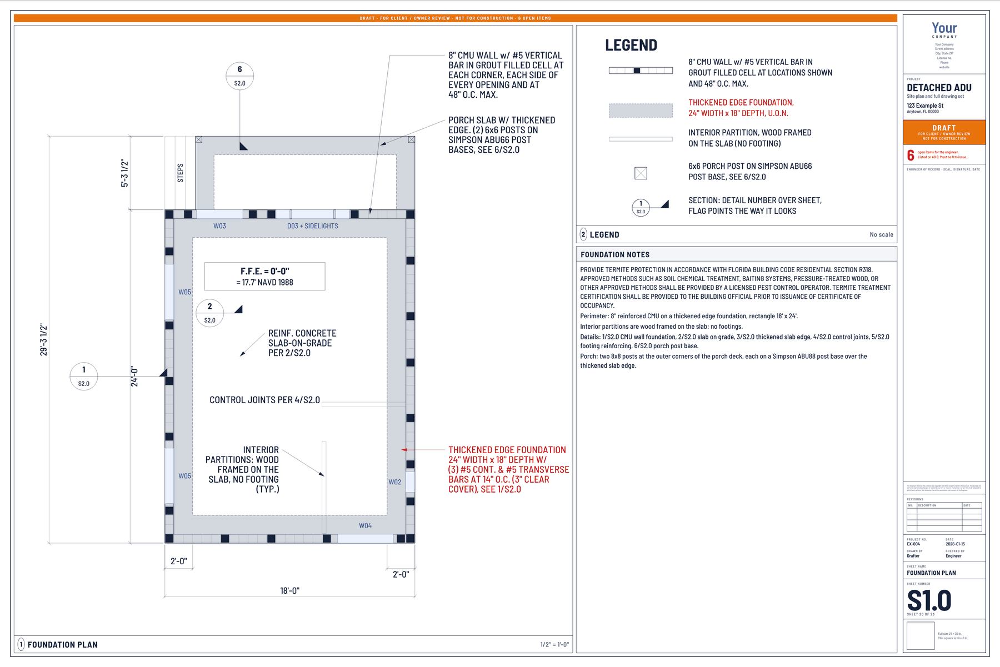
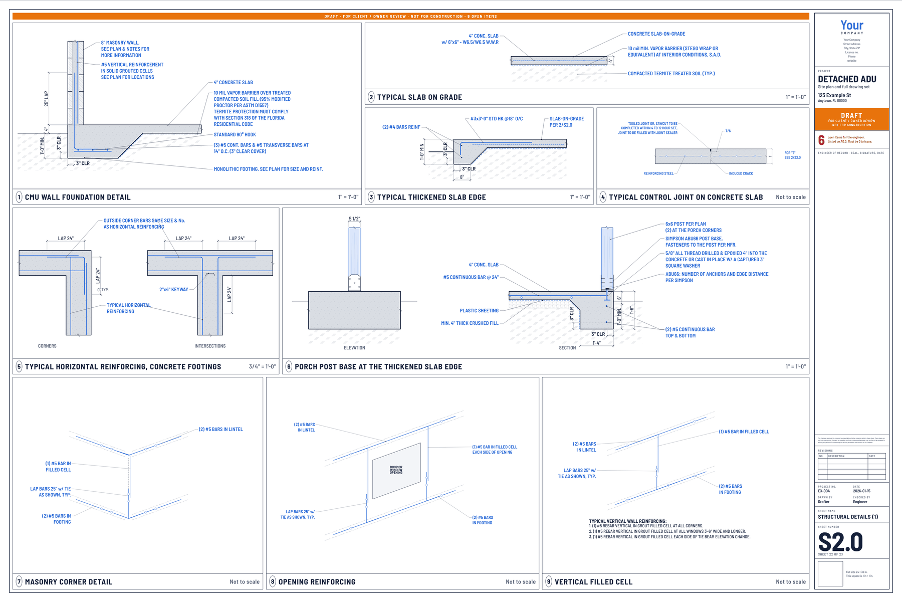

# Detached ADU

A 23-sheet draft set for a detached accessory dwelling unit: a 432 sq ft studio with a covered porch. Cover,
2 civil, 9 architectural, 2 mechanical, 2 plumbing, 2 electrical and 5 structural sheets. It is a working
draft for owner review, with open items, published as an example of a full small-building set.

## What is here

`sheet-set.html` is a pre-drawn copy of the set: every sheet is plain HTML and SVG, with the fonts inside, and
it needs no JavaScript. Open it in a browser; print it from the browser to get the 36 x 24 in PDF.

There is no `project.json` for this example yet, so it is not rebuilt by `build.py` and the Edit panel is not
there. The project file and its drawing code follow when the job is final.

## What was anonymized

- Address, city, street name, owner names, project number, permit and special-use numbers, folio and parcel
  numbers, legal description, subdivision, neighborhood, zoning district and code section numbers: placeholders
  or removed.
- Surveyor's name and survey date, flood panel number, lot-line angles, and dated remarks: removed.
- Firm block, logo, drafter and checker initials, issue date: placeholders.
- C001: the site plan and the two site sections are left blank. Their linework is removed from the file, not
  hidden. Site data, the stormwater check and the trench detail stay.
- Rendering, aerial view, parcel map and the 811 mark: grey boxes of the same size.
- The QR code in the title block, which pointed to the project's page: removed.
- A title block left over from another job inside the hidden CAD source pages: replaced with placeholders.

## Known limits

- It is a draft: six open items for the engineer are listed on the cover, and some details are still being tuned.
- On the plans and elevations taken from CAD plots the text is drawn as outlines, so it cannot be searched or
  selected.
- Floor and grade elevations are as drawn.

A set is a draft until a licensed engineer seals it. This example is not a design for any site.
