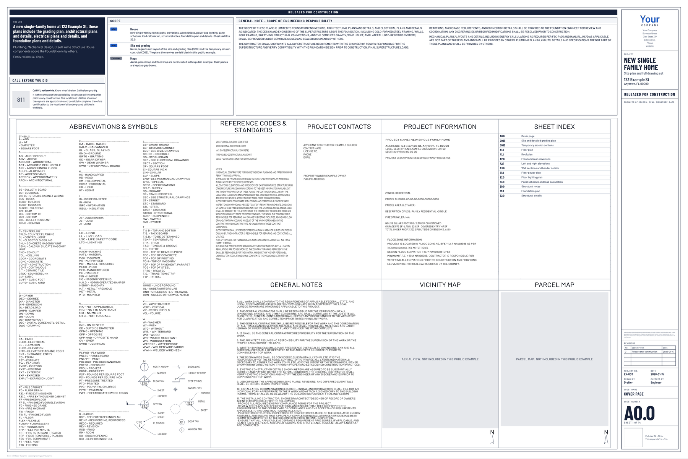
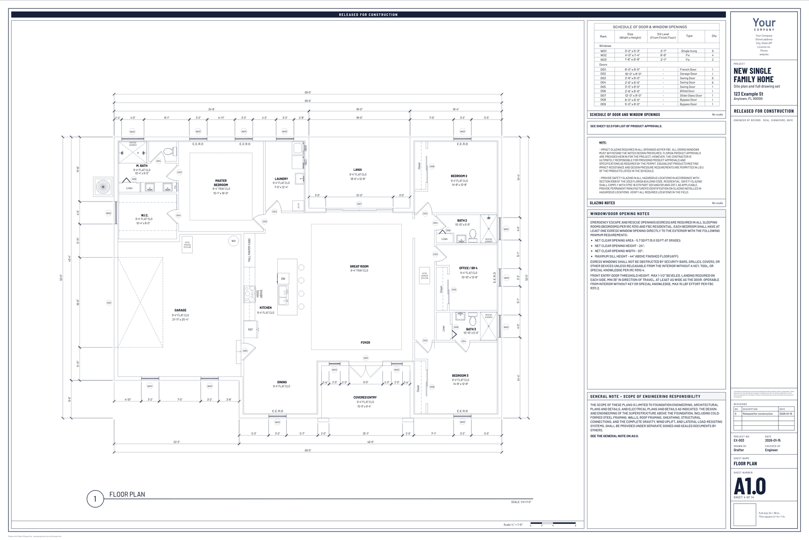
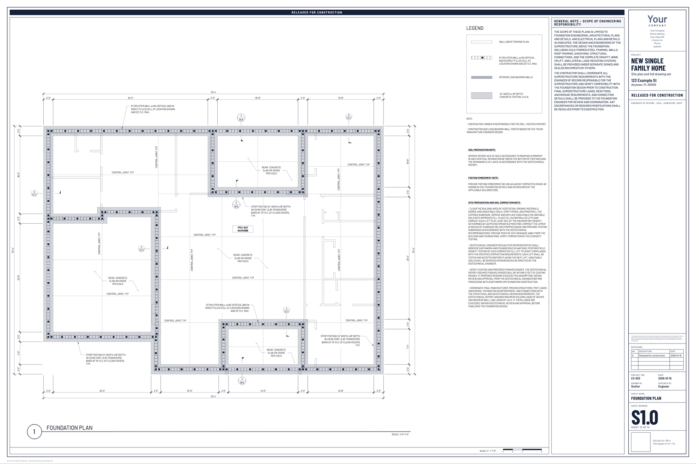
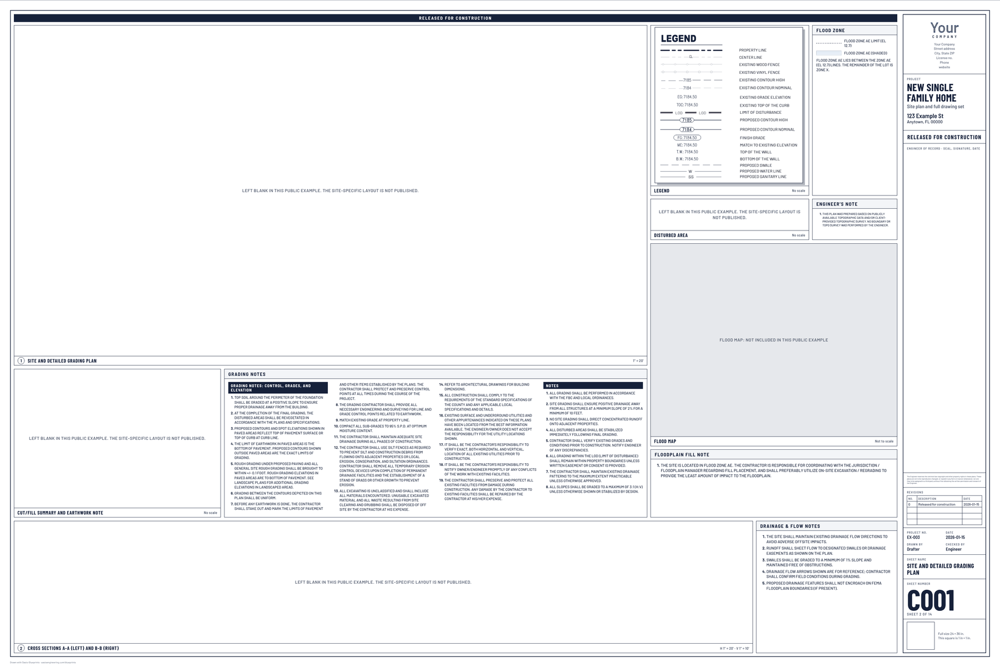

# Residential set from CAD

A 14-sheet set for a new single-family home: cover, 2 civil, 6 architectural, 3 electrical and 3 structural
sheets. The linework comes from CAD and is redrawn in the kit's ink and type; notes, schedules and tables are
typeset natively. It is the first full set made this way, published as a worked example.






## What is here

| File | What it is |
|---|---|
| `project.json` | The project file: sheets, panels, native notes and tables, placeholders |
| `cadset.js` | Job type `cadset`: CAD windows inside kit panels at true paper size, overlays, inserts, native note and table panels, placeholder boxes, a copyright line in the title block. The CAD sheet data is the last line of the file |
| `source/native.py` | How the structural notes, the product schedule, the wind tables and the electrical tables were typeset. The wind calculation is a stub that returns fixed example results |

Not here yet: the scripts that redraw a plot page as SVG, assemble the sheet data, set the PDF properties and
bookmarks, and the worked project definition. They are added when they have been cleaned of job paths and names.

## Build it

From the repository root:

```bash
python skills/oasis-blueprints/scripts/build.py examples/sheet-sets/residential-set/project.json residential-set.html
python skills/oasis-blueprints/scripts/print.py residential-set.html residential-set.pdf
```

`build.py` finds `cadset.js` beside the project file. `print.py` runs the layout audit and writes the PDF.

## What was anonymized

- Address, city, street names, project number, lot and block: placeholders (`123 Example St`, `EX-003`).
- Owner, contractor, licence, phone, email, parcel numbers, legal description: placeholders.
- Flood panel number and county name: removed. Flood and floor elevations: lowered by 50 ft.
- Firm block, logo, drafter and checker initials, issue and revision dates: placeholders.
- C001 and C002: the plans, cross sections, cut and fill summary and disturbed-area table are left blank. Notes,
  legends and layout stay.
- Aerial view, parcel map, flood map and the five erosion control details: grey boxes of the same size. The
  details were third-party manual pages and are not republished. The 811 mark is a text box.
- Title blocks of the source CAD sheets: removed from the data.

## Known limits

- The DWG converter drops lineweights and hatches, so most sheets are redrawn from vector plots of the CAD
  layouts instead.
- New geometry added on a sheet (a callout, a revised detail) is placed by hand.
- The layout audit checks overflow and true plotted size. It does not check that two things collide.
- Tinted fills in the plots are stored as vector rectangles traced from the plot, so curved fill edges are stepped.

A set is a draft until a licensed engineer seals it. This example is not a design for any site.
