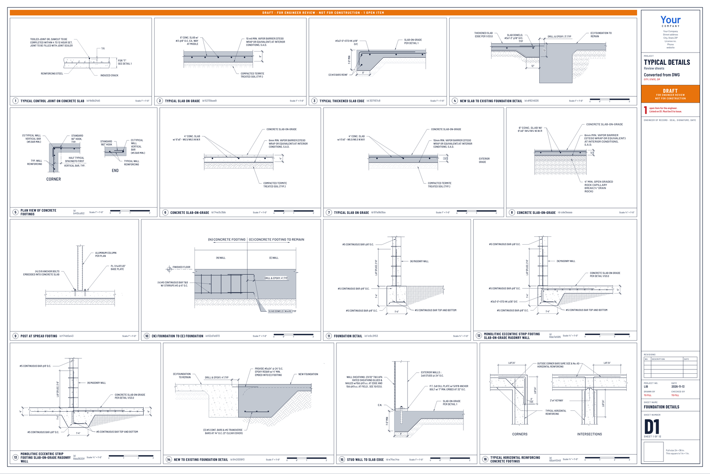

# Detail library

Construction details kept as data, so the Oasis-Blueprints kit can draw them on a sheet at true scale, in numbered panels,
with the same pens and fonts as the rest of the set. Each detail is one small JSON file (`oasis-blueprints/detail/0.1`).

**These are reference details, not a design.** They were converted from an engineering firm's CAD drawings and redraw what
those drawings show, notes included. A detail belongs on a set only when the engineer of record for that job says it applies,
and it is the engineer who checks it. Details marked "not yet" in the tables below were converted by machine and have not
been compared line by line with their source.

## Use one in a set

In the project file, name the collection folder and list the ids on a sheet of type `details`:

```json
"library": "library/details/typical",
"sheets": [
  { "no": "S5.0", "type": "details", "name": "Standard details", "details": ["62d7e973", "7fd7c8dc"] }
]
```

See `skills/oasis-blueprints/references/project-file.md`, "Library details". A set made only of such sheets uses `"jobType": "library"`.

## Typical details

72 details in [`typical/`](typical/). Index: [`typical/index.json`](typical/index.json).



Every sheet: [1](typical/sheets/sheet-01.png) · [2](typical/sheets/sheet-02.png) · [3](typical/sheets/sheet-03.png) · [4](typical/sheets/sheet-04.png) · [5](typical/sheets/sheet-05.png) · [6](typical/sheets/sheet-06.png) · [7](typical/sheets/sheet-07.png) · [8](typical/sheets/sheet-08.png) · [9](typical/sheets/sheet-09.png) · [10](typical/sheets/sheet-10.png) · [11](typical/sheets/sheet-11.png) · [12](typical/sheets/sheet-12.png).

| Id | Detail | Category | Scale | Checked by the engineer |
|---|---|---|---|---|
| `62d7e973` | (N) FOUNDATION TO (E) FOUNDATION | Foundation | 1"=1'-0" | not yet |
| `7fd7c8dc` | CMU WALL FOUNDATION DETAIL | Foundation | 1"=1'-0" | not yet |
| `74e3c3bb` | CONCRETE SLAB-ON-GRADE | Foundation | 1"=1'-0" | not yet |
| `cde3eaaa` | CONCRETE SLAB-ON-GRADE | Foundation | 3/4"=1'-0" | not yet |
| `1c6c3f53` | FOUNDATION DETAIL | Foundation | 3/4"=1'-0" | not yet |
| `6d083ed4` | FOUNDATION DETAIL | Foundation | 1 1/2"=1'-0" | not yet |
| `bc6f0581` | FOUNDATION DETAIL | Foundation | 1 1/2"=1'-0" | not yet |
| `c837f3b5` | FOUNDATION DETAIL | Foundation | 1"=1'-0" | not yet |
| `e0f1541c` | FOUNDATION DETAIL | Foundation | 1"=1'-0" | not yet |
| `0e1c1c7b` | HOLDOWN ANCHORAGE AT FOUNDATION | Foundation | 1"=1'-0" | not yet |
| `8da3620f` | MONOLITHIC ECCENTRIC STRIP FOOTING SLAB-ON-GRADE MASONRY WALL | Foundation | 3/4"=1'-0" | not yet |
| `8de7e595` | MONOLITHIC ECCENTRIC STRIP FOOTING SLAB-ON-GRADE MASONRY WALL | Foundation | 3/4"=1'-0" | not yet |
| `df824626` | NEW SLAB TO EXISTING FOUNDATION DETAIL | Foundation | 1"=1'-0" | not yet |
| `842009f3` | NEW TO EXISTING FOUNDATION DETAIL | Foundation | 1"=1'-0" | not yet |
| `63d80e90` | PIPE SLEEVE THROUGH CONCRETE FOOTING OR STEM WALL | Foundation | 1"=1'-0" | not yet |
| `b410cd52` | PLAN VIEW OF CONCRETE FOOTINGS | Foundation | 1"=1'-0" | not yet |
| `f74b5a43` | POST AT SPREAD FOOTING | Foundation | 1"=1'-0" | not yet |
| `ce0bbc73` | POST FOOTING DETAIL | Foundation | 1"=1'-0" | not yet |
| `e7fac14a` | STUD WALL TO SLAB EDGE | Foundation | 1"=1'-0" | not yet |
| `fb6b2fa5` | TYPICAL CONTROL JOINT ON CONCRETE SLAB | Foundation | 1"=1'-0" | not yet |
| `66a4f048` | TYPICAL HORIZONTAL REINFORCING CONCRETE FOOTINGS | Foundation | 3/4"=1'-0" | not yet |
| `8afda42b` | TYPICAL PIER FOOTING | Foundation | 1"=1'-0" | not yet |
| `5270bae9` | TYPICAL SLAB ON GRADE | Foundation | 1"=1'-0" | not yet |
| `97a9b3ba` | TYPICAL SLAB ON GRADE | Foundation | 1"=1'-0" | not yet |
| `acbb4f00` | TYPICAL SLAB ON GRND OPTIONAL | Foundation | 3/4"=1'-0" | not yet |
| `307167c8` | TYPICAL THICKENED SLAB EDGE | Foundation | 1"=1'-0" | not yet |
| `79d4258d` | HOLES & NOTCHES IN SILL PLATES | Wall | Not to scale | not yet |
| `7afa61cc` | HOLES & NOTCHES IN STUDS | Wall | Not to scale | not yet |
| `9ace72b6` | SHEAR WALL SCHEDULE | Wall | 1"=1'-0" | not yet |
| `bdd52af6` | SILL PLATE BOLTING | Wall | Not to scale | not yet |
| `b759977e` | TOP PLATE SPLICE | Wall | Not to scale | not yet |
| `188587ed` | TYPICAL MASONRY WALL CONSTRUCTION | Wall | Not to scale | not yet |
| `d3c48102` | TYPICAL MASONRY WALL CONSTRUCTION | Wall | 3/4"=1'-0" | not yet |
| `3883bbc0` | TYPICAL MASONRY WALL REINFORCING | Wall | Not to scale | not yet |
| `14f78936` | TYPICAL OPENING IN STUD WALL | Wall | Not to scale | not yet |
| `d266197f` | TYPICAL OPENING IN STUD WALL | Wall | 3/4"=1'-0" | not yet |
| `3321c7a2` | TYPICAL SHEAR WALL FRAMING | Wall | 1/2"=1'-0" | not yet |
| `f30cc509` | TYPICAL SHEAR WALL FRAMING | Wall | 1/2"=1'-0" | not yet |
| `2932f86a` | BEAM TO WALL | Beam | 1"=1'-0" | not yet |
| `16d2ab1d` | TYPICAL CMU BOND BEAM DETAIL | Beam | 1"=1'-0" | not yet |
| `bfe0d84d` | TYPICAL HORIZONTAL REINFORCING MASONRY BOND BEAMS | Beam | 3/4"=1'-0" | not yet |
| `23bc244a` | TYPICAL JOIST & BEAM HANGER SCHEDULE | Beam | Not to scale | not yet |
| `6f31a461` | BEAM TO COLUMN CMU | Post-Column | 1/2"=1'-0" | not yet |
| `9007860d` | CORNER PORCH POST DETAIL | Post-Column | 1"=1'-0" | not yet |
| `fd2a2257` | DROP BEAM TO POST CONNECTION | Post-Column | 1"=1'-0" | not yet |
| `b707e39c` | HOLES & NOTCHES IN SAWN LUMBER JOISTS | Joist-Floor | Not to scale | not yet |
| `fe96eae3` | TYPICAL TEE BLOCKING DETAIL | Joist-Floor | 1"=1'-0" | not yet |
| `0fcc2854` | CRICKET ROOF DETAIL | Roof | 1"=1'-0" | not yet |
| `680dd459` | FRAMING AT ROOF RAFTERS | Roof | 1"=1'-0" | not yet |
| `738adfa3` | FRAMING AT ROOF RAFTERS | Roof | 1"=1'-0" | not yet |
| `b65380c8` | RIDGE BEAM TO KING POST | Roof | 1"=1'-0" | not yet |
| `26d43a33` | ROOF FRAMING AT EXTERIOR WALL | Roof | 1"=1'-0" | not yet |
| `03539570` | ROOF FRAMING AT RIDGE | Roof | 1"=1'-0" | not yet |
| `57331eeb` | ROOF FRAMING AT RIDGE BOARD | Roof | 1"=1'-0" | not yet |
| `fff21c7f` | TRUSS TO CMU WALL | Roof | Not to scale | not yet |
| `52d7338b` | TYPICAL WOOD TRUSS AT DROP BEAM | Roof | 1"=1'-0" | not yet |
| `53841420` | TYPICAL WOOD TRUSS AT WALL | Roof | 1"=1'-0" | not yet |
| `05a90a9c` | STAGGERED PANEL EDGE NAILING | Connection | 1"=1'-0" | not yet |
| `507bc4f7` | TYPICAL MASONRY OPENING | Door-Window | Not to scale | not yet |
| `1d2e96b5` | TYPICAL SIDEWALL FLASHING DETAIL | Ledger | Not to scale | not yet |
| `789c2f44` | FIBERGLASS STAIR TIE DOWN DETAIL | Stairs | 1"=1'-0" | not yet |
| `834a9cf6` | CHIMNEY CAP DETAIL | Other | 1"=1'-0" | not yet |
| `9ed793cc` | HOLES & NOTCHES IN LSL/LVL/PSL | Other | 1"=1'-0" | not yet |
| `b7d9a6d1` | REBAR DEVELOPMENT LENGTHS | Other | 1"=1'-0" | not yet |
| `44f030d6` | TYPICAL HORIZONTAL DIAPHRAGMS | Other | Not to scale | not yet |
| `9e78ec51` | TYPICAL HORIZONTAL DIAPHRAGMS | Other | Not to scale | not yet |
| `6b1e5c26` | TYPICAL LINTEL ASSEMBLY | Other | 3/4"=1'-0" | not yet |
| `23226033` | TYPICAL PIPE & TRENCH DETAIL | Other | 1"=1'-0" | not yet |
| `088c3281` | TYPICAL PIPE EXCAVATION | Other | 3/4"=1'-0" | not yet |
| `671f2130` | TYPICAL REBAR BENDS | Other | 3"=1'-0" | not yet |
| `0bcac0b0` | TYPICAL S.W AT CORNER | Other | 1"=1'-0" | not yet |
| `0fe85c4a` | VAULTED CEILING | Other | 1/2"=1'-0" | not yet |
