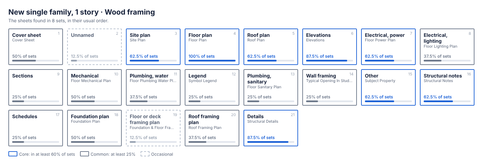

# Drawing map

What a standard drawing set contains, by project type, measured from real permit sets.

For each type and variant of residential job the map lists the sheets a set normally has (the sheet index, in
its usual order), the views on each sheet, the details, and the note blocks, each with how often it appears.
`template_seed` in every type file is the starting sheet list for an Oasis-Blueprints template of that type.

This first map is built from 30 residential Oasis Engineering permit sets. Commercial jobs are left out.

**Read it here: [every type, with its sheet index, details and note blocks](types/README.md).**



The map counts what past sets contained. It does not say what a new job requires: the engineer of record decides
which sheets, details and notes a set needs. Most types here rest on one to three sets and are marked "thin" on
their pages; treat their shares as provisional until more sets are read.

## Files

| File | What it is |
|---|---|
| `types/README.md` | the index for people: every type, its set count and its core sheets |
| `types/<type>__<variant>.md` | the page for one type: sheet index, details, note blocks, starter sheet list |
| `types/<type>__<variant>.png` | a picture of the usual set for that type, sheet by sheet |
| `types/<type>__<variant>.json` | the same map as data (`__all` rolls up every variant of a type) |
| `index.json` | list of the type files with set counts |
| `taxonomy.json` | project types, variants and the rules that sort a set into them |
| `sheet_kinds.json` | the standard kinds of sheet and the sheet names that map to them |
| `tools/map_sets.py` | the script that reads the sets and writes all of the above |

Each type file has `sheets` (kind, share of sets, usual position, usual names and numbering, views), `details`,
`notes` (heading, share, the most common wording) and `template_seed`. An item is `core` when it is in at least
60% of the sets of that type, `common` from 25%, `occasional` below.

## Anonymised

- No file holds a set's name, path, address, client, owner, parcel number or contact.
- Text appears only if at least two different jobs share it. Anything seen in one job only is counted under
  `unlisted` and left out.
- Names of people, firms and product brands are replaced with `{person}`, `{company}` and `{manufacturer}`.
  Emails, websites, phone numbers, licence numbers, states and years become `{email}`, `{website}`, `{phone}`,
  `{license}`, `{state}` and `{year}`.

## Running it on your own sets

Needs Python 3.8+ and either Poppler's `pdftotext`, `pdfminer.six` (or `pdfplumber`), or `pypdf`.

```bash
python tools/map_sets.py --root "path/to/drawing sets" status
python tools/map_sets.py --root "path/to/drawing sets" scan --time-budget 0
python tools/map_sets.py --root "path/to/drawing sets" build
```

One PDF is one set. `scan` only reads the drawings; everything is written inside this folder. Edit
`taxonomy.json` and `sheet_kinds.json` and run `build` again as often as needed.

`build` also writes the pages and pictures in `types/`. To rewrite only those from the existing type files, with
no scan data needed:

```bash
python tools/map_sets.py pages
```

The pictures need Playwright and Chromium (the same as the skill's `print.py`); without them the pages are written
and the pictures are skipped (`--no-pictures` does the same on purpose). Do not edit the `.md` files by hand.

Local-only files, never committed (see `.gitignore`):

- `_state/sets.jsonl`: what was read from each PDF, including paths and one-off text.
- `_state/scrub_names.json`: the people, firms and brands to replace (`{"person": [...], "company": [...], "manufacturer": [...]}`).
- `_state/local.json`: site settings: `top_only` (root files only), `ignore` (folders to skip),
  `titleblock_words`, `exclude_from_publish` (sets to keep out of the published files).
- `sets.csv`, `unmapped_sheet_names.csv`: per-set review lists, with paths.
- `review.html`: the whole map as one page with a side menu, for reading in a browser.

Sets the taxonomy cannot sort are never published.
