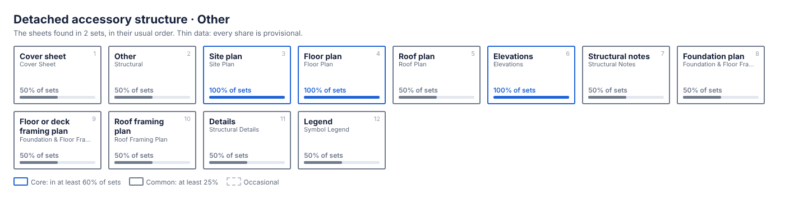

# Detached accessory structure · Other

2 sets, 9 to 12 sheets, typically 10.5. Data: [`detached-accessory__general.json`](detached-accessory__general.json). All types: [index](README.md).

> **Thin data.** This page is built from 2 sets, so every share below is provisional: one set makes every sheet read as "core".

Seen in these sets: stories: 1 (2); roof: hip (1); foundation: slab (1).

Left out because they appear in one set only: 2 sheet names, 2 note blocks.

## Sheet index

| Sheet | In sets | Tier | Usual name | Numbering |
|---|---|---|---|---|
| **Cover sheet** | `█████░░░░░` 50% | common | COVER SHEET | A |
| **Other** | `█████░░░░░` 50% | common | STRUCTURAL also: CONCRETE SLAB-ON-GRADE | S · 4 sheets |
| **Site plan** | `██████████` 100% | core | SITE PLAN | A |
| **Floor plan** | `██████████` 100% | core | FLOOR PLAN | A |
| **Roof plan** | `█████░░░░░` 50% | common | ROOF PLAN | A |
| **Elevations** | `██████████` 100% | core | ELEVATIONS also: FRONT ELEVATION | A · 1.5 sheets |
| **Structural notes** | `█████░░░░░` 50% | common | STRUCTURAL NOTES | S |
| **Foundation plan** | `█████░░░░░` 50% | common | FOUNDATION & FLOOR FRAMING PLAN | S |
| **Floor or deck framing plan** | `█████░░░░░` 50% | common | FOUNDATION & FLOOR FRAMING PLAN | S |
| **Roof framing plan** | `█████░░░░░` 50% | common | ROOF FRAMING PLAN | S |
| **Details** | `█████░░░░░` 50% | common | STRUCTURAL DETAILS | S · 3 sheets |
| **Legend** | `█████░░░░░` 50% | common | SYMBOL LEGEND | E, P · 2 sheets |

No view titles are listed: none is shared by two or more sets of this type.

## Details

None listed: no detail title is shared by two or more sets of this type.

## Note blocks

Open a block to read its most common wording. Placeholders in braces stand for a state, year, phone number, company or manufacturer.

<b>CONCRETE SLAB-ON-GRADE</b> · core · 100% of sets · 2.5 items · on details, other

<ol><li>6mm MIN. VAPOR BARRIER ({manufacturer} WRAP OR EQUIVALENT) AT INTERIOR CONDITIONS, S.A.D. " 4</li><li>2. 3. 4. 5. 6. 7. 8.</li><li>3. 4. WALL SHEATHING SHALL BE APPLIED OVER STUDS SPACED AT 16"o.c. ALL SILL FASTENING TO CONCRETE SHALL HAVE AS A MINIMUM 5 5. SHALL EXTEND TO WITHIN 1 NAILS PENETRATING PRESSURE TREATED WOOD SHALL BE HOT-DIPPED GALVANIZED PER ASTM A153, CLASS D. DBL. 2x STUDS AT ABUTTING PANEL EDGES SHALL BE FASTENED TOGETHER w/ 16d NAILS AT EDGE NAIL SPACING. NAILING SPACED AT 3"o.c. OR LESS SHALL BE STAGGERED 1</li><li>7. 8.</li></ol>

<i>Most common wording, in 1 set. 2 wordings seen.</i>

<b>GENERAL NOTES</b> · common · 50% of sets · 3 items · on cover, site_plan, roof_plan

<ol><li>ALL WORK PERFORMED SHALL COMPLY WITH THE CONTRACT DOCUMENTS, DRAWINGS AND SPECIFICATIONS, INCLUDING THESE GENERAL NOTES.</li><li>ALL MATERIALS AND WORKMANSHIP SHALL CONFORM TO THE DRAWINGS AND SPECIFICATIONS. IF A CONFLICT IS FOUND BETWEEN DRAWINGS, GENERAL NOTES OR SPECIFICATIONS, CONSULT THE LEAD DESIGNER FOR CLARIFICATION BEFORE PROCEEDING WITH THE WORK</li><li>NO DEVIATION FROM DRAWINGS AND SPECIFICATIONS SHALL BE MADE</li></ol>

<i>Most common wording, in 1 set. 4 wordings seen.</i>

<b>CODE / AUTHORITY</b> · common · 50% of sets · 1 items · on cover

<i>Wording seen in one set only, so it is left out of the map.</i>

<b>SYMBOLS &amp; LEGENDS</b> · common · 50% of sets · 1 items · on cover

<ol><li>FLOOR LEVEL 0' - 0" 1 A ROOM NAME - - - - 1 A.3 3 S2.0 A D C</li></ol>

<i>Most common wording, in 1 set. 1 wording seen.</i>

<b>SECTION CUT MARKER</b> · common · 50% of sets · 4 items · on cover

<ol><li>DIRECTION OF CUT SECTION DRAWING NUMBER SECTION DRAWING SHEET NUMBER</li><li>FIRE PROTECTION EQUIPMENT AND SERVICE ACCESS MUST BE PROVIDED DURING THE CONSTRUCTION PERIOD OR AS REQUIRED BY THE CITY FIRE DEPARTMENT</li><li>BUILDER SHALL MAINTAIN CLEAR EXIT(S) AND TEMPORARY EXIT SIGNS TO</li><li>ALL APPLICABLE CODE DESIGNATIONS SHALL COMPLY WITH THE MOST</li></ol>

<i>Most common wording, in 1 set. 1 wording seen.</i>

<b>NOTE OR NOTATION</b> · common · 50% of sets · 1 items · on cover

<ol><li>AN ARCHITECTURAL SHEET OR SCHEDULE INDICATES THAT DIMENSIONS PROVIDED ELSEWHERE SHALL GOVERN</li></ol>

<i>Most common wording, in 1 set. 1 wording seen.</i>

<b>DESIGN CRITERIA</b> · common · 50% of sets · 1 items · on structural_notes

<i>Wording seen in one set only, so it is left out of the map.</i>

<b>CONCRETE MASONRY</b> · common · 50% of sets · 11 items · on structural_notes

<ol><li>Construct masonry in accordance with ACI 530/ASCE 5, "Building Code Requirements for Concrete Masonry Structures"; and ACI 530.1/ASCE 6, "Specifications for the Design and Construction of Load-Bearing Concrete Masonry".</li><li>The structure is supported by bearing walls, u.o.n. Erect masonry prior to casting concrete columns within bearing walls or casting beams and slabs supported by bearing walls.</li><li>Use 50% solid, nominal 8x8x16, concrete masonry units conforming to ASTM C90. Block net area compressive strength shall be 2,000 psi. Determine the minimum f'm of 1,500 psi by the unit test method or prism method. Lay up units in running bond. Sawcut units which are not in multiples of 8". Units shall be at least 8" long. Bond corners by lapping ends 8" in successive vertical courses. Design of walls is based on a f'm of 2,000 psi.</li><li>Use Type S mortar in accordance with ASTM C270 except use Type M mortar below grade. Head and bed joints shall be 3/8" for the thickness of the face shell. Webs are to be fully mortared in all courses of piers, columns and pilasters; in the starting course; and where an adjacent cell is to be grouted. Remove mortar protrusions extending 1/2" or more into cells to be grouted.</li><li>Use standard (9 gauge) horizontal joint reinforcing in every other course. Joint reinforcing and anchors in exterior walls shall conform to ASTM A 153 Class B2, with a coating thickness of 1.50 oz/sf; conform to ASTM A 641 at interior walls. Overlap discontinuous ends 6". Use prefabricated corners and tees. Use ladder type in walls with vertical reinforcing. Extend joint reinforcing a minimum of 4" into tie columns.</li><li>Use fine grout conforming to ASTM C-476, with a minimum compressive strength of 2,500 psi in 28 days. Aggregate to conform to ASTM C404 for fine grout, with slump of 8" to 10". Grout all masonry containing reinforcing, all cells of 4 hour rated walls, and where indicated on the drawings. Allow mortar to cure 24 hours prior to grouting. Provide cleanout openings at the base of cells containing reinforcing steel to clean the cell and to tie the vertical bar to the dowel.</li><li>Use ASTM A-615 Grade 60 reinforcing steel. Reinforce walls where indicated on the drawings and at all intersections, each side of openings and at the ends of walls. Use bar spacers at 10'-0" O/C where grout pour height exceeds 10'-0".</li><li>Reinforced masonry wall construction shall be inspected by an Engineer or Architect in accordance with ACI 530.1/ASCE 6.</li><li>Where anchor bolts, wedge anchors or anchors set in epoxy are set in a masonry wall, fill cells with grout for bolted course, one course above and two courses below.</li><li>Provide lintels or headers with min. 8" bearing over all masonry openings.</li><li>Use pressure-treated wood for wood in contact with masonry.</li></ol>

<i>Most common wording, in 1 set. 1 wording seen.</i>

<b>DEMOLITION NOTES</b> · common · 50% of sets · 8 items · on structural_notes

<ol><li>At all locations where new construction will interface with existing elements, cut through existing structure in straight and true lines to insure a neat interface.</li><li>At all locations where the demolition of a concrete member leaves the ends of reinforcing steel exposed, provide the following:</li><li>Chip concrete from around the steel to a depth of 1".</li><li>Cut off reinforcing steel not less than 3/4" below the concrete surface.</li><li>Fill the cavity flush with a high modulus gel epoxy. See specifications for accepted manufacturers.</li><li>Before demolishing any structural element, install all required temporary and/or permanent bracing and supports.</li><li>Provide temporary closure of all roof fascia, wall and other openings to protect building from exposure to undesirable elements until new construction is weatherproofed, at which time such temporary construction shall be removed. All temporary exterior walls that are subject to wind loads are to be designed by a {state} Licensed Delegated Engineer.</li><li>Upon completion of new construction under each phase, all demolished areas shall be restored to acceptable usage according to the contract documents as determined by the Architect or Engineer.</li></ol>

<i>Most common wording, in 1 set. 1 wording seen.</i>

<b>STRUCTURAL STEEL</b> · common · 50% of sets · 10 items · on structural_notes

<ol><li>Fabricate and erect structural steel in conformance with AISC "Specification for Structural Steel Buildings", with Commentary, AISC “Code of Standard Practice for Steel Buildings and Bridges”, AISC “Specification for Structural Joints Using ASTM A325 and A490 Bolts, including Commentary” and all OSHA requirements.</li><li>Submit, to the Architect, complete fabrication and erection drawings prepared by or under the direct supervision of a {state} licensed engineer (Delegated Engineer). Details or connections changed or proposed by the fabricator shall be signed, sealed and dated by the Delegated Engineer.</li><li>Fabricate structural steel shapes from the following materials:</li><li>Plates: ASTM A36.</li><li>All shop and field welding procedures and personnel shall conform to AWS D1.1 Structural Welding Code- Steel. Use E70 series welding electrodes, u.o.n. Where necessary, remove galvanizing or primer prior to welding.</li><li>Cut, drill, or punch holes perpendicular to metal surfaces. Ream holes that must be enlarged to admit bolts as permitted by Architect. Do not enlarge unfair holes by burning or using drift pins.</li><li>Do not splice structural steel members except where indicated on the drawings.</li><li>Steel erector to furnish and install temporary bracing as necessary to provide a stable structure during construction.</li><li>See Architectural and Mechanical Drawings for miscellaneous steel not shown on the Structural Drawings.</li><li>Refer to Architectural Drawings for painting and fireproofing of structural steel. In the absence of other instructions, paint all non-galvanized steel with a lead and chromate free steel primer. Do not paint steel surfaces in contact with concrete or to be fireproofed.</li></ol>

<i>Most common wording, in 1 set. 1 wording seen.</i>

<b>SHALLOW FOUNDATIONS</b> · common · 50% of sets · 2 items · on structural_notes

<ol><li>As per visual inspection soil conditions at this site are sand &amp; rock with a min bearing capacity of {year} psf should other conditions or materials be encountered, the engineer shall be notified prior to proceeding with the work the architect or engineer shall supply a letter attesting that the site has been observed and the foundation conditions are similar to those upon which the design is based on.</li><li>Center all footings under their respective columns or walls, u.o.n.</li></ol>

<i>Most common wording, in 1 set. 1 wording seen.</i>

<b>EXCAVATION, BACKFILL AND DEWATERING</b> · common · 50% of sets · 3 items · on structural_notes

<ol><li>The Contractor is solely responsible for all excavation procedures including lagging, shoring, and protection of adjacent property, structures, streets and utilities in accordance with the requirements of the local building department and OSHA regulations. Do not excavate within one foot of the angle of repose of any soil bearing foundation unless the foundation is properly protected against settlement.</li><li>Do not backfill against walls until 7 days after the walls are braced by the structure or are temporarily braced. Do not backfill cantilevered retaining walls until concrete is 28 days old. Do not backfill until after completion and inspection of any waterproofing.</li><li>The Contractor is responsible for the disposal of all accumulated water in a manner that does not inconvenience or damage the work.</li></ol>

<i>Most common wording, in 1 set. 1 wording seen.</i>

<b>WOOD</b> · common · 50% of sets · 6 items · on structural_notes

<ol><li>All wood construction and connections shall conform to AITC “American Institute of Timber Construction” Manual, and the “National Design Specifications” for Wood Construction, {year} Edition, and {state} Building Code, Chapter 23.</li><li>All member sizes are to be as shown on drawing and provide the following minimum properties: Member Species Joists So. Pine No. 2</li><li>All wood in contact with concrete or masonry shall be pressure treated.</li><li>All bolts and bolted connections shall conform to ASTM A325, Anchor bolts is F1554-Grade 55. Use washers between wood and all bolt heads and nuts.</li><li>All metal wood connectors shall be galvanized and shall be manufactured by {manufacturer} Co., or approved equal.</li><li>All joists shall be laterally supported at ends by solid blocking.</li></ol>

<i>Most common wording, in 1 set. 1 wording seen.</i>

<b>SLABS-ON-GRADE</b> · common · 50% of sets · 4 items · on structural_notes

<ol><li>Above subgrade, use fill containing not more than 10% passing #200 sieve and maximum 1 inch diameter. Compact to 95% of maximum dry density as determined by modified proctor ASTM D-1557. Each layer of fill shall not exceed 6" loose thickness. Compact prior to placement of the next layer.</li><li>Fill placement and compaction shall be monitored and accepted by the testing agency. Take a min. of one field density test (ASTM D-1556 or D-2922) for each 2,500 square feet of each layer. The testing agency shall randomly select test locations.</li><li>For interior slabs place 10 mil polyethylene sheeting between soil and bottom of slab. Do not use any sheeting below exterior concrete slabs. Sheets shall be lapped 6” minimum and taped. Seal all penetrations, including pipes, with tape.</li><li>See the Architectural Drawings for slab-on-grade depressions and other requirements.</li></ol>

<i>Most common wording, in 1 set. 1 wording seen.</i>

<b>REINFORCED CONCRETE</b> · common · 50% of sets · 12 items · on structural_notes

<ol><li>Provide Structural Concrete and concreting practices complying with ACI 301 and 318.</li><li>Provide structural concrete proportioned in accordance with ACI 318, Ch. 5.3, with a minimum ultimate compressive design strength in 28 days as follows: Element Footings Slabs-on-Grade Submit statistical data, not more than one year old, for each class of concrete.</li><li>Use normal weight concrete for all structural members. u.o.n.</li><li>Aggregates are to be clean, free of chlorides, and complying with ASTM C33 gradations. Maximum coarse aggregate size 1" (C33 size 57). Minimum F.M. for fine aggregate is 2.4. Use admixtures conforming to ASTM C494. Provide type A, D, F or G admix in all structural concrete and Type D or G when ambient temperature is 85 degrees or higher. Design concrete, with strengths less than 4500 psi, with 4% +/- 1% entrained air, except for trowel finished floors. Do not use calcium chloride in any concrete.</li><li>Obtain composite samples of fresh concrete according to ASTM C172. Obtain at least one composite sample for each 100 cu. yd. or fraction thereof of each concrete mix placed each day. For slabs, increase frequency to each 50 cu. yd. or fraction placed each day. Take a slump test, ASTM C143, for each composite sample. Maximum permissible slump is 5 inches. Cast and laboratory cure one set of four compression test standard cylinders, per ASTM C31, for each composite sample. For pumped concrete, take sample at point of placement. Test, per ASTM C39,</li><li>Provide ASTM A-615 Grade 60 reinforcing steel. Reinforcing shall be accurately placed, rigidly supported and firmly tied in place, with</li><li>Where specified, provide plain, cold-drawn electrically-welded wire reinforcement conforming to ASTM A-185. Supply in flat sheets only. Lap</li><li>Utilities shall not penetrate beams or columns but may pass through slabs and walls individually, u.o.n. For openings 24" long or less, cut</li><li>Where reinforcing steel congestion permits, conduit and pipes up to 1" diameter may be embedded in concrete per ACI 318, Section 20.7. Space at 3 diameters o.c. Place between outer layers of reinforcing if conduits are significantly congested, additional reinforcing perpendicular to piping may be required. Requests to embed larger pipes should be accompanied by a detailed description and be submitted to the architect for evaluation.</li><li>Provide construction joints in accordance with ACI 318, Section 6.4. Provide keyways and adequate dowels. Submit drawings showing location</li><li>Provide 3/4" chamfer for all exposed corners.</li><li>Provide reinforcing steel placer with a set of Structural Drawings for field reference. Inspect reinforcing steel placing from structural drawings.</li></ol>

<i>Most common wording, in 1 set. 1 wording seen.</i>

<b>DENOTES {manufacturer} HANGER PER SCHEDULE 4/S2.1, U.O.N</b> · common · 50% of sets · 1 items · on foundation_plan, roof_framing_plan

<ol><li>DENOTES {manufacturer} CONCEALED FLANGE HANGER PER SCHEDULE 4/S2.1, U.O.N. SEE HEADER SCHEDULE ON 8/S2.1 FOR HEADER SIZES, UNLESS NOTED ON PLAN. 15" WIDE x 18" CONCRETE FOOTING, U.O.N.</li></ol>

<i>Most common wording, in 1 set. 1 wording seen.</i>

<b>NOTE</b> · common · 50% of sets · 3 items · on foundation_plan, roof_framing_plan

<ol><li>- STUD PACK FRAMING:</li><li>2X STUD PACK UNDER EACH END OF SOLID SAWN BEAM. (6) 2X STUD PACK UNDER EACH END OF GLULAM BEAM. (SEE PLAN FOR BEAM SIZE)</li><li>- CONTRACTOR/ OWNER IS RESPONSIBLE FOR THE SOIL / GEOTECH REPORT.</li></ol>

<i>Most common wording, in 1 set. 1 wording seen.</i>

<b>STUDS PER SHEAR WALL SCHEDULE</b> · common · 50% of sets · 3 items · on details

<ol><li>3x SILL PLATE w/ 5</li><li>TYPICAL WALL VERTICAL BAR (#5 BAR MIN.)</li><li>TYPICAL WALL VERTICAL BAR (#5 BAR MIN.)</li></ol>

<i>Most common wording, in 1 set. 1 wording seen.</i>

<b>SHEAR WALL SCHEDULE</b> · common · 50% of sets · 1 items · on details

<ol><li>"APA RATED" 2" WALL SHEATHING STRUCT 1 TYPE PER PLAN 6 4 3 2 4 - 4</li></ol>

<i>Most common wording, in 1 set. 1 wording seen.</i>

<b>EDGE NAILING (E.N.)</b> · common · 50% of sets · 1 items · on details

<ol><li>BOUNDARY NAILING (B.N.) AT PERIMETER, SAME AS EDGE NAILING, U.O.N. 4'-0"x8'-0" SHEATHING WITH FACE GRAIN PERPENDICULAR TO JOISTS, PLACE IN A STAGGERED JOINT PATTERN, TYP. U.O.N. 2</li></ol>

<i>Most common wording, in 1 set. 2 wordings seen.</i>

<b>WIDTH</b> · common · 50% of sets · 4 items · on details

<ol><li>BORED HOLES: MAX. DIAMETER 40% OF WIDTH</li><li>USE CONCEALED FLANGE HANGERS ONLY WHERE INDICATED ON PLANS 5. HANGERS PRODUCED BY {manufacturer}, U.O.N., OR EQUIVALENT APPROVED BY</li><li>7. PROVIDE MAXIMUM FASTENERS LISTED BY MANUFACTURER 8. CONTACT STRUCTURAL ENGINEER OF RECORD FOR BEAM SIZES NOT SHOWN</li><li>2x12</li></ol>

<i>Most common wording, in 1 set. 1 wording seen.</i>

<b>ELECTRICAL NOTES</b> · common · 50% of sets · 3 items · on legend

<i>Wording seen in one set only, so it is left out of the map.</i>

<b>PLUMBING NOTES</b> · common · 50% of sets · 2 items · on legend

<i>Wording seen in one set only, so it is left out of the map.</i>

## Starter sheet list

The core sheets in their usual order (`template_seed` in the data file). It is a count of what past sets contained, not a statement of what a new job requires.

1. SITE PLAN (`site_plan`)
2. FLOOR PLAN (`floor_plan`)
3. ELEVATIONS (`elevations`)

Core note blocks: CONCRETE SLAB-ON-GRADE.
