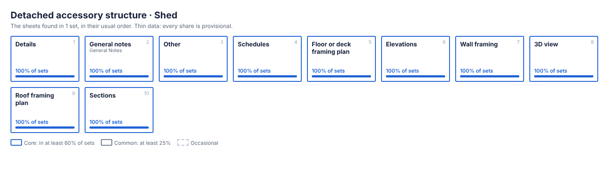

# Detached accessory structure · Shed

1 set, 19 to 19 sheets, typically 19. Data: [`detached-accessory__shed.json`](detached-accessory__shed.json). All types: [index](README.md).

> **Thin data.** This page is built from 1 set, so every share below is provisional: one set makes every sheet read as "core".

Left out because they appear in one set only: 15 sheet names, 8 note blocks.

## Sheet index

| Sheet | In sets | Tier | Usual name | Numbering |
|---|---|---|---|---|
| **Details** | `██████████` 100% | core |  | S · 6 sheets |
| **General notes** | `██████████` 100% | core | GENERAL NOTES | S |
| **Other** | `██████████` 100% | core |  | 2 sheets |
| **Schedules** | `██████████` 100% | core |  | S |
| **Floor or deck framing plan** | `██████████` 100% | core |  | 3 sheets |
| **Elevations** | `██████████` 100% | core |  | 3 sheets |
| **Wall framing** | `██████████` 100% | core |  | 2 sheets |
| **3D view** | `██████████` 100% | core |  |  |
| **Roof framing plan** | `██████████` 100% | core |  |  |
| **Sections** | `██████████` 100% | core |  |  |

No view titles are listed: none is shared by two or more sets of this type.

## Details

None listed: no detail title is shared by two or more sets of this type.

## Note blocks

Open a block to read its most common wording. Placeholders in braces stand for a state, year, phone number, company or manufacturer.

<b>GENERAL NOTES</b> · core · 100% of sets · 1 items · on general_notes

<i>Wording seen in one set only, so it is left out of the map.</i>

<b>NOTES</b> · core · 100% of sets · 3 items · on schedules

<i>Wording seen in one set only, so it is left out of the map.</i>

## Starter sheet list

The core sheets in their usual order (`template_seed` in the data file). It is a count of what past sets contained, not a statement of what a new job requires.

1. Details (`details`)
2. GENERAL NOTES (`general_notes`)
3. Schedules (`schedules`)
4. Floor or deck framing plan (`floor_framing_plan`)
5. Elevations (`elevations`)
6. Wall framing (`wall_framing`)
7. 3D view (`view_3d`)
8. Roof framing plan (`roof_framing_plan`)
9. Sections (`sections`)

Core note blocks: GENERAL NOTES, NOTES.
