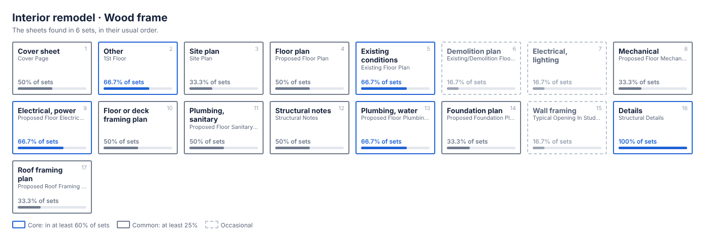

# Interior remodel · Wood frame

6 sets, 7 to 13 sheets, typically 11. Data: [`interior-remodel__wood-frame.json`](interior-remodel__wood-frame.json). All types: [index](README.md).

Seen in these sets: stories: 1 (4), 2 (1); walls: wood (1); flood: True (1).

Left out because they appear in one set only: 28 sheet names, 2 details, 11 note blocks.

## Sheet index

| Sheet | In sets | Tier | Usual name | Numbering | Views on it |
|---|---|---|---|---|---|
| **Cover sheet** | `█████░░░░░` 50% | common | COVER PAGE | A |  |
| **Other** | `███████░░░` 66.7% | core | 1ST FLOOR also: S.W. POST; SYMBOLS & ABBREVIATIONS | A, S, P · 3.5 sheets |  |
| **Site plan** | `███░░░░░░░` 33.3% | common | SITE PLAN | A |  |
| **Floor plan** | `█████░░░░░` 50% | common | PROPOSED FLOOR PLAN also: EXISTING FLOOR PLAN; EXISTING/DEMOLITION FLOOR PLAN | A · 2 sheets |  |
| **Existing conditions** | `███████░░░` 66.7% | core | EXISTING FLOOR PLAN also: EXISTING/DEMOLITION FLOOR PLAN | A, E, P · 1.5 sheets |  |
| **Demolition plan** | `██░░░░░░░░` 16.7% | occasional | EXISTING/DEMOLITION FLOOR PLAN | A |  |
| **Electrical, lighting** | `██░░░░░░░░` 16.7% | occasional |  | E |  |
| **Mechanical** | `███░░░░░░░` 33.3% | common | PROPOSED FLOOR MECHANICAL PLAN | M |  |
| **Electrical, power** | `███████░░░` 66.7% | core | PROPOSED FLOOR ELECTRICAL PLAN | E |  |
| **Floor or deck framing plan** | `█████░░░░░` 50% | common |  | S |  |
| **Plumbing, sanitary** | `█████░░░░░` 50% | common | PROPOSED FLOOR SANITARY PLAN | P |  |
| **Structural notes** | `█████░░░░░` 50% | common | STRUCTURAL NOTES | S |  |
| **Plumbing, water** | `███████░░░` 66.7% | core | PROPOSED FLOOR PLUMBING WATER PLAN | P |  |
| **Foundation plan** | `███░░░░░░░` 33.3% | common | PROPOSED FOUNDATION PLAN | S |  |
| **Wall framing** | `██░░░░░░░░` 16.7% | occasional | TYPICAL OPENING IN STUD WALL | S |  |
| **Details** | `██████████` 100% | core | STRUCTURAL DETAILS | S, E, M |  |
| **Roof framing plan** | `███░░░░░░░` 33.3% | common | PROPOSED ROOF FRAMING PLAN | S |  |

## Details

None listed: no detail title is shared by two or more sets of this type.

## Note blocks

Open a block to read its most common wording. Placeholders in braces stand for a state, year, phone number, company or manufacturer.

<b>GENERAL NOTES</b> · core · 83.3% of sets · 14 items · on structural_notes, other, cover

<ol><li>The governing Code for this Project is the {year} {state} Building Code, 8th Edition. This Code prescribes which edition of each referenced standard applies to this Project.</li><li>To the best of our knowledge, the Structural Drawings and these Specification Notes comply with the applicable requirements of the governing Building Code.</li><li>Construction is to comply with the requirements of the governing Building Code and all other applicable Federal, State, and Local Codes, Standards, Regulations and Laws.</li><li>The Structural Documents are to be used in conjunction with the Architectural Documents. If a conflict exists, the more stringent governs.</li><li>Details labeled "TYP" apply to all situations that are the same or similar to those specifically referenced, whether or not they are keyed in at each location. Questions regarding the applicability of typical details shall be resolved by the Architect.</li><li>Openings shown on Structural Drawings are only pictorial. See the Architectural and M.E.P. drawings for the size and location of openings in the structure.</li><li>Contractors who discover discrepancies, omissions or variations in the Contract Documents during bidding shall immediately notify the Architect. The Architect will resolve the condition and issue a written clarification.</li><li>The Contractor shall coordinate all Contract Documents with field conditions and dimensions and Project Shop Drawings prior to construction. Do not scale drawings; use only printed dimensions. Report any discrepancies in writing to the Architect prior to proceeding with work. Do not change size or location of structural members without written instructions from the Structural Engineer of Record.</li><li>The Contractor shall protect adjacent property, his own work and the public from harm. The Contractor is solely responsible for construction means and methods, and jobsite safety including all OSHA requirements.</li><li>The Structure is designed to be structurally sound when completed. Prior to completion, the Contractor is responsible for stability and temporary bracing, including, but not limited to, masonry walls. Wherever the Contractor is unsure of these requirements, the Contractor shall retain a {state} Licensed Engineer to design and inspect the temporary bracing and stability of the structure.</li><li>For installation of {manufacturer} components and connectors, refer to manufacturer specifications.</li><li>Contractor shall exercise extreme caution in areas of buried utilities by calling {company} at {phone}. the contractor is responsible for repairing and contacting all utilities.</li><li>Design Superimposed Loads: OCCUPANCY/USE Roof Attic Floor Wall Deck</li><li>Design Wind Loads Governing Code Building Risk Category Ultimate Wind Speed Mean Roof Height Directionality Factor Gust-Effect Factor Exposure Internal Pressure Coefficient</li></ol>

<i>Most common wording, in 3 sets. 4 wordings seen.</i>

<b>DEMOLITION NOTES</b> · core · 83.3% of sets · 8 items · on structural_notes, other, details

<ol><li>At all locations where new construction will interface with existing elements, cut through existing structure in straight and true lines to insure a neat interface.</li><li>At all locations where the demolition of a concrete member leaves the ends of reinforcing steel exposed, provide the following:</li><li>Chip concrete from around the steel to a depth of 1".</li><li>Cut off reinforcing steel not less than 3/4" below the concrete surface.</li><li>Fill the cavity flush with a high modulus gel epoxy. See specifications for accepted manufacturers.</li><li>Before demolishing any structural element, install all required temporary and/or permanent bracing and supports.</li><li>Provide temporary closure of all roof fascia, wall and other openings to protect building from exposure to undesirable elements until new construction is weatherproofed, at which time such temporary construction shall be removed. All temporary exterior walls that are subject to wind loads are to be designed by a {state} Licensed Delegated Engineer.</li><li>Upon completion of new construction under each phase, all demolished areas shall be restored to acceptable usage according to the contract documents as determined by the Architect or Engineer.</li></ol>

<i>Most common wording, in 4 sets. 2 wordings seen.</i>

<b>CONCRETE MASONRY</b> · core · 66.7% of sets · 11 items · on structural_notes, other

<ol><li>Construct masonry in accordance with ACI 530/ASCE 5, "Building Code Requirements for Concrete Masonry Structures"; and ACI 530.1/ASCE 6, "Specifications for the Design and Construction of Load-Bearing Concrete Masonry".</li><li>The structure is supported by bearing walls, u.o.n. Erect masonry prior to casting concrete columns within bearing walls or casting beams and slabs supported by bearing walls.</li><li>Use 50% solid, nominal 8x8x16, concrete masonry units conforming to ASTM C90. Block net area compressive strength shall be 2,000 psi. Determine the minimum f'm of 1,500 psi by the unit test method or prism method. Lay up units in running bond. Sawcut units which are not in multiples of 8". Units shall be at least 8" long. Bond corners by lapping ends 8" in successive vertical courses. Design of walls is based on a f'm of 2,000 psi.</li><li>Use Type S mortar in accordance with ASTM C270 except use Type M mortar below grade. Head and bed joints shall be 3/8" for the thickness of the face shell. Webs are to be fully mortared in all courses of piers, columns and pilasters; in the starting course; and where an adjacent cell is to be grouted. Remove mortar protrusions extending 1/2" or more into cells to be grouted.</li><li>Use standard (9 gauge) horizontal joint reinforcing in every other course. Joint reinforcing and anchors in exterior walls shall conform to ASTM A 153 Class B2, with a coating thickness of 1.50 oz/sf; conform to ASTM A 641 at interior walls. Overlap discontinuous ends 6". Use prefabricated corners and tees. Use ladder type in walls with vertical reinforcing. Extend joint reinforcing a minimum of 4" into tie columns.</li><li>Use fine grout conforming to ASTM C-476, with a minimum compressive strength of 2,500 psi in 28 days. Aggregate to conform to ASTM C404 for fine grout, with slump of 8" to 10". Grout all masonry containing reinforcing, all cells of 4 hour rated walls, and where indicated on the drawings. Allow mortar to cure 24 hours prior to grouting. Provide cleanout openings at the base of cells containing reinforcing steel to clean the cell and to tie the vertical bar to the dowel.</li><li>Use ASTM A-615 Grade 60 reinforcing steel. Reinforce walls where indicated on the drawings and at all intersections, each side of openings and at the ends of walls. Use bar spacers at 10'-0" O/C where grout pour height exceeds 10'-0".</li><li>Reinforced masonry wall construction shall be inspected by an Engineer or Architect in accordance with ACI 530.1/ASCE 6.</li><li>Where anchor bolts, wedge anchors or anchors set in epoxy are set in a masonry wall, fill cells with grout for bolted course, one course above and two courses below.</li><li>Provide lintels or headers with min. 8" bearing over all masonry openings.</li><li>Use pressure-treated wood for wood in contact with masonry.</li></ol>

<i>Most common wording, in 4 sets. 1 wording seen.</i>

<b>STRUCTURAL STEEL</b> · core · 66.7% of sets · 10 items · on structural_notes, other

<ol><li>Fabricate and erect structural steel in conformance with AISC "Specification for Structural Steel Buildings", with Commentary, AISC “Code of Standard Practice for Steel Buildings and Bridges”, AISC “Specification for Structural Joints Using ASTM A325 and A490 Bolts, including Commentary” and all OSHA requirements.</li><li>Submit, to the Architect, complete fabrication and erection drawings prepared by or under the direct supervision of a {state} licensed engineer (Delegated Engineer). Details or connections changed or proposed by the fabricator shall be signed, sealed and dated by the Delegated Engineer.</li><li>Fabricate structural steel shapes from the following materials:</li><li>Plates: ASTM A36.</li><li>All shop and field welding procedures and personnel shall conform to AWS D1.1 Structural Welding Code- Steel. Use E70 series welding electrodes, u.o.n. Where necessary, remove galvanizing or primer prior to welding.</li><li>Cut, drill, or punch holes perpendicular to metal surfaces. Ream holes that must be enlarged to admit bolts as permitted by Architect. Do not enlarge unfair holes by burning or using drift pins.</li><li>Do not splice structural steel members except where indicated on the drawings.</li><li>Steel erector to furnish and install temporary bracing as necessary to provide a stable structure during construction.</li><li>See Architectural and Mechanical Drawings for miscellaneous steel not shown on the Structural Drawings.</li><li>Refer to Architectural Drawings for painting and fireproofing of structural steel. In the absence of other instructions, paint all non-galvanized steel with a lead and chromate free steel primer. Do not paint steel surfaces in contact with concrete or to be fireproofed.</li></ol>

<i>Most common wording, in 4 sets. 1 wording seen.</i>

<b>SHALLOW FOUNDATIONS</b> · core · 66.7% of sets · 2 items · on structural_notes, other

<ol><li>As per visual inspection soil conditions at this site are sand &amp; rock with a min bearing capacity of {year} psf should other conditions or materials be encountered, the engineer shall be notified prior to proceeding with the work the architect or engineer shall supply a letter attesting that the site has been observed and the foundation conditions are similar to those upon which the design is based on.</li><li>Center all footings under their respective columns or walls, u.o.n.</li></ol>

<i>Most common wording, in 4 sets. 1 wording seen.</i>

<b>EXCAVATION, BACKFILL AND DEWATERING</b> · core · 66.7% of sets · 3 items · on structural_notes, other

<ol><li>The Contractor is solely responsible for all excavation procedures including lagging, shoring, and protection of adjacent property, structures, streets and utilities in accordance with the requirements of the local building department and OSHA regulations. Do not excavate within one foot of the angle of repose of any soil bearing foundation unless the foundation is properly protected against settlement.</li><li>Do not backfill against walls until 7 days after the walls are braced by the structure or are temporarily braced. Do not backfill cantilevered retaining walls until concrete is 28 days old. Do not backfill until after completion and inspection of any waterproofing.</li><li>The Contractor is responsible for the disposal of all accumulated water in a manner that does not inconvenience or damage the work.</li></ol>

<i>Most common wording, in 4 sets. 1 wording seen.</i>

<b>SLABS-ON-GRADE</b> · core · 66.7% of sets · 4 items · on structural_notes, other

<ol><li>Above subgrade, use fill containing not more than 10% passing #200 sieve and maximum 1 inch diameter. Compact to 95% of maximum dry density as determined by modified proctor ASTM D-1557. Each layer of fill shall not exceed 6" loose thickness. Compact prior to placement of the next layer.</li><li>Fill placement and compaction shall be monitored and accepted by the testing agency. Take a min. of one field density test (ASTM D-1556 or D-2922) for each 2,500 square feet of each layer. The testing agency shall randomly select test locations.</li><li>For interior slabs place 10 mil polyethylene sheeting between soil and bottom of slab. Do not use any sheeting below exterior concrete slabs. Sheets shall be lapped 6” minimum and taped. Seal all penetrations, including pipes, with tape.</li><li>See the Architectural Drawings for slab-on-grade depressions and other requirements.</li></ol>

<i>Most common wording, in 4 sets. 1 wording seen.</i>

<b>WOOD</b> · core · 66.7% of sets · 6 items · on structural_notes, other

<ol><li>All wood construction and connections shall conform to AITC “American Institute of Timber Construction” Manual, and the “National Design Specifications” for Wood Construction, {year} Edition, and {state} Building Code, Chapter 23.</li><li>All member sizes are to be as shown on drawing and provide the following minimum properties: Member Species Joists So. Pine No. 2</li><li>All wood in contact with concrete or masonry shall be pressure treated.</li><li>All bolts and bolted connections shall conform to ASTM A325, Anchor bolts is F1554-Grade 55. Use washers between wood and all bolt heads and nuts.</li><li>All metal wood connectors shall be galvanized and shall be manufactured by {manufacturer} Co., or approved equal.</li><li>All joists shall be laterally supported at ends by solid blocking.</li></ol>

<i>Most common wording, in 2 sets. 3 wordings seen.</i>

<b>REINFORCED CONCRETE</b> · core · 66.7% of sets · 8 items · on structural_notes, other

<ol><li>Provide Structural Concrete and concreting practices complying with ACI 301 and 318.</li><li>Provide structural concrete proportioned in accordance with ACI 318, Ch. 5.3, with a minimum ultimate compressive design strength in 28 days as follows: Element Footings Slabs-on-Grade Submit statistical data, not more than one year old, for each class of concrete.</li><li>Use normal weight concrete for all structural members. u.o.n.</li><li>Aggregates are to be clean, free of chlorides, and complying with ASTM C33 gradations. Maximum coarse aggregate size 1" (C33 size 57). Minimum F.M. for fine aggregate is 2.4. Use admixtures conforming to ASTM C494. Provide type A, D, F or G admix in all structural concrete and Type D or G when ambient temperature is 85 degrees or higher. Design concrete, with strengths less than 4500 psi, with 4% +/- 1% entrained air, except for trowel finished floors. Do not use calcium chloride in any concrete.</li></ol>

<i>Most common wording, in 2 sets. 2 wordings seen.</i>

<b>PLUMBING NOTES</b> · common · 50% of sets · 2 items · on plumbing_sanitary, plumbing_water

<ol><li>THE CONTRACTOR SHALL FURNISH ALL LABOR, MATERIALS, AND EQUIPMENT NECESSARY FOR THE INSTALLATION OF A COMPLETE SCOPE OF WORK. ALL WORKMANSHIP AND MATERIALS SHALL BE IN STRICT ACCORDANCE WITH THE {state} BUILDING CODE 8TH EDITION ({year}) - PLUMBING, APPLICABLE LOCAL CODES,RULES AND ORDINANCES.</li><li>PLUMBING CONTRACTOR SHALL VISIT THE JOB SITE AND THOROUGHLY FAMILIARIZE HIMSELF WITH ALL</li></ol>

<i>Most common wording, in 3 sets. 1 wording seen.</i>

<b>DEAD LOAD</b> · common · 33.3% of sets · 9 items · on structural_notes, other

<ol><li>17 psf 5 psf 20 psf 12 psf 15 psf</li><li>Obtain composite samples of fresh concrete according to ASTM C172. Obtain at least one composite sample for each 100 cu. yd. or fraction thereof of each concrete mix placed each day. For slabs, increase frequency to each 50 cu. yd. or fraction placed each day. Take a slump test, ASTM C143, for each composite sample. Maximum permissible slump is 5 inches. Cast and laboratory cure one set of four compression test standard cylinders, per ASTM C31, for each composite sample. For pumped concrete, take sample at point of placement. Test, per ASTM C39, one cylinder at 7 days and three at 28 days. If one of the first two 28 day tests falls below the specified strength, test the remaining cylinder at 56 days. No concrete test will be accepted if concrete is tampered with in any way after sample is obtained. Repeat sampling if water is added after initial sample is obtained.</li><li>Provide ASTM A-615 Grade 60 reinforcing steel. Reinforcing shall be accurately placed, rigidly supported and firmly tied in place, with appropriate bar supports and spacers. Conform to ACI 301, 315, 318 and CRSI Manual of Standard Practice. Lap continuous reinforcing 48 bar dia. Lap bottom steel over supports and top steel at midspan (u.o.n.). Hook discontinuous ends of all top bars and all bars in walls, u.o.n. Provide clear cover over reinforcing as follows:</li><li>Where specified, provide plain, cold-drawn electrically-welded wire reinforcement conforming to ASTM A-185. Supply in flat</li><li>Utilities shall not penetrate beams or columns but may pass through slabs and walls individually, u.o.n. For openings 24" long or</li><li>Where reinforcing steel congestion permits, conduit and pipes up to 1" diameter may be embedded in concrete per ACI 318,</li><li>Provide construction joints in accordance with ACI 318, Section 6.4. Provide keyways and adequate dowels. Submit drawings</li><li>Provide 3/4" chamfer for all exposed corners.</li><li>Provide reinforcing steel placer with a set of Structural Drawings for field reference. Inspect reinforcing steel placing from</li></ol>

<i>Most common wording, in 2 sets. 1 wording seen.</i>

<b>DEFLECTION DESIGN CRITERIA</b> · common · 33.3% of sets · 1 items · on structural_notes

<i>Wording seen in one set only, so it is left out of the map.</i>

<b>NOTE</b> · common · 33.3% of sets · 2.5 items · on other, floor_framing_plan

<ol><li>- STUD PACK FRAMING:</li><li>2X STUD PACK UNDER EACH END OF SOLID SAWN BEAM. (6) 2X STUD PACK UNDER EACH END OF GLULAM BEAM. (SEE PLAN FOR BEAM SIZE)</li><li>- CONTRACTOR/ OWNER IS RESPONSIBLE FOR THE SOIL / GEOTECH REPORT.</li></ol>

<i>Most common wording, in 1 set. 2 wordings seen.</i>

<b>EDGE NAILING (E.N.)</b> · common · 33.3% of sets · 1.5 items · on wall_framing, details

<i>Wording seen in one set only, so it is left out of the map.</i>

<b>SHOWER NOTES</b> · common · 33.3% of sets · 1.5 items · on plumbing_water

<ol><li>FIXTURES FLOWS AND CONSUMPTION SHALL CONFORM TO M.D.C., ORDINANCE 8-14 SECTION 8-31. 2. SHOWER/TUB SHALL BE PRESSURE BALANCED THERMOSTATIC MIXING OR CONTROL VALVES VALVES PER FBC R-P-2708.4</li></ol>

<i>Most common wording, in 1 set. 2 wordings seen.</i>

<b>PLUMBING PLAN NOTES</b> · common · 33.3% of sets · 1 items · on plumbing_water, plumbing_sanitary

<ol><li>- PLUMBING FIXTURE LOCATIONS SHOWN ARE DIAGRAMMATIC ONLY AND FOR REFERENCE PURPOSES. - FINAL PIPE SIZING, MATERIALS, AND ROUTING SHALL BE COORDINATED WITH THE LICENSED PLUMBING CONTRACTOR. - WATER, SEWER, AND VENT SYSTEM DESIGN, SIZING, AND CONNECTION DETAILS SHALL BE PROVIDED AND CERTIFIED BY OTHERS. - CONTRACTOR SHALL VERIFY ALL FIXTURE LOCATIONS AND CLEARANCES IN FIELD PRIOR TO INSTALLATION. - ALL WORK SHALL COMPLY WITH THE {year} {state} BUILDING CODE - PLUMBING AND LOCAL UTILITY REQUIREMENTS.</li></ol>

<i>Most common wording, in 2 sets. 1 wording seen.</i>

<b>EQUIPMENT, ETC</b> · common · 33.3% of sets · 14 items · on plumbing_sanitary

<i>Wording seen in one set only, so it is left out of the map.</i>

<b>FLOOD DAMAGE-RESISTANT MATERIALS</b> · common · 33.3% of sets · 3.5 items · on details

<i>Wording seen in one set only, so it is left out of the map.</i>

<b>DENOTES {manufacturer} HANGER PER SCHEDULE 4/S3.0, U.O.N</b> · occasional · 16.7% of sets · 1 items · on other

<i>Wording seen in one set only, so it is left out of the map.</i>

<b>S.W. POST</b> · occasional · 16.7% of sets · 3 items · on other

<i>Wording seen in one set only, so it is left out of the map.</i>

<b>SHEAR WALL SCHEDULE</b> · occasional · 16.7% of sets · 1 items · on floor_framing_plan

<ol><li>"APA RATED" 2" WALL SHEATHING STRUCT 1 TYPE PER PLAN 6 4 3 2 4 - 4</li></ol>

<i>Most common wording, in 1 set. 1 wording seen.</i>

<b>WIDTH</b> · occasional · 16.7% of sets · 4 items · on wall_framing

<ol><li>BORED HOLES: MAX. DIAMETER 40% OF WIDTH</li><li>USE CONCEALED FLANGE HANGERS ONLY WHERE INDICATED ON PLANS 5. HANGERS PRODUCED BY {manufacturer}, U.O.N., OR EQUIVALENT APPROVED BY</li><li>7. PROVIDE MAXIMUM FASTENERS LISTED BY MANUFACTURER 8. CONTACT STRUCTURAL ENGINEER OF RECORD FOR BEAM SIZES NOT SHOWN</li><li>2x12</li></ol>

<i>Most common wording, in 1 set. 1 wording seen.</i>

<b>SCHEDULE OF DOOR &amp; WINDOW OPENINGS</b> · occasional · 16.7% of sets · 1 items · on floor_plan

<i>Wording seen in one set only, so it is left out of the map.</i>

<b>DESIGN CRITERIA</b> · occasional · 16.7% of sets · 1 items · on structural_notes

<i>Wording seen in one set only, so it is left out of the map.</i>

<b>NOTES</b> · occasional · 16.7% of sets · 1 items · on cover

<i>Wording seen in one set only, so it is left out of the map.</i>

<b>DEMOLITION SCOPE OF WORK</b> · occasional · 16.7% of sets · 1 items · on details

<i>Wording seen in one set only, so it is left out of the map.</i>

<b>ELECTRICAL NOTES</b> · occasional · 16.7% of sets · 4 items · on electrical_power

<i>Wording seen in one set only, so it is left out of the map.</i>

<b>SMOKECO2 DETECTOR NOTES</b> · occasional · 16.7% of sets · 1 items · on electrical_power

<i>Wording seen in one set only, so it is left out of the map.</i>

<b>TABLE 710.1(1) BUILDING DRAINS AND SEWERS</b> · occasional · 16.7% of sets · 1 items · on plumbing_water

<ol><li>DIAMETER OF PIPE (inches) 1-1 4 *1-1 2 *2 2-1 2 *3 4 5 6 8 10 12 15</li></ol>

<i>Most common wording, in 1 set. 1 wording seen.</i>

<b>CONNECTIONS</b> · occasional · 16.7% of sets · 1 items · on plumbing_water

<i>Wording seen in one set only, so it is left out of the map.</i>

<b>PERMITTED BY THIS CODE. FPC 1002.1</b> · occasional · 16.7% of sets · 1 items · on plumbing_water

<i>Wording seen in one set only, so it is left out of the map.</i>

<b>NOTE FOR TUB &amp; SHOWER VALVES</b> · occasional · 16.7% of sets · 1 items · on plumbing_water

<ol><li>424.3 INDIVIDUAL SHOWER VALVES. INDIVIDUAL SHOWER AND TUB-SHOWER COMBINATION VALVES SHALL BE BALANCED-PRESSURE, THERMOSTATIC OR COMBINATION BALANCED-PRESSURETHERMOSTATIC VALVES THAT CONFORM TO THE REQUIREMENTS OF ASSE 1016ASME A112.1016CSA B125.16 OR ASME A112.18.1CSA B125.1 AND SHALL BE INSTALLED AT THE POINT OF USE. SHOWER AND TUB-SHOWER COMBINATION VALVES REQUIRED BY THIS SECTION SHALL BE EQUIPPED WITH A MEANS TO LIMIT THE MAXIMUM SETTING OF THE VALVE TO 120°F (49°C), WHICH SHALL BE FIELD ADJUSTED IN ACCORDANCE WITH THE MANUFACTURER’S INSTRUCTIONS. IN-LINE THERMOSTATIC VALVES SHALL NOT BE UTILIZED FOR COMPLIANCE WITH THIS SECTION. 606.2 LOCATION OF SHUTOFF VALVES. SHUTOFF VALVES SHALL BE INSTALLED IN THE FOLLOWING LOCATIONS: 1.ON THE FIXTURE SUPPLY TO EACH PLUMBING FIXTURE OTHER THAN BATHTUBS AND SHOWERS IN ONE- AND TWO-FAMILY RESIDENTIAL OCCUPANCIES, AND OTHER THAN IN INDIVIDUAL SLEEPING UNITS THAT ARE PROVIDED WITH UNIT SHUTOFF VALVES IN HOTELS, MOTELS, BOARDING HOUSES AND SIMILAR OCCUPANCIES. 2.ON THE WATER SUPPLY PIPE TO EACH SILLCOCK. 3.ON THE WATER SUPPLY PIPE TO EACH APPLIANCE OR MECHANICAL EQUIPMENT.</li></ol>

<i>Most common wording, in 1 set. 1 wording seen.</i>

<b>SHOWER ENCLOSURE NOTES</b> · occasional · 16.7% of sets · 1 items · on plumbing_water

<ol><li>FBC P2708 SHOWERS SHOWER COMPARTMENTS SHALL HAVE NO LESS THAN 30 IN. MIN. DIMENSION, AND AN AREA NO LESS 900 S.I. COMPLY WITH THIS SECTION. 417.4.1 WALL AREA THE WALL AREA ABOVE BUILT-IN TUBS WITH INSTALLED SHOWER HEADS AND IN SHOWER COMPARTMENTS SHALL BE CONSTRUCTED OF SMOOTH, NONCORROSIVE AND NONABSORBENT WATERPROOF MATERIALS RED GUARD OR {manufacturer} TO A HEIGHT NOT LESS THAN 6 FEET ABOVE THE ROOM FLOOR LEVEL AND NOT LESS THAN 70 INCHES WHERE MEASURED FROM THE COMPARTMENT FLOOR AT THE DRAIN. SUCH WALLS SHALL FORM A WATER -TIGHT JOINT WITH EACH OTHER AND WITH EITHER THE TUB RECEPTOR OR SHOWER FLOOR. A WATERPROOFING INSPECTION IS REQUIRED BEFORE TILE IS SET. 417.5.2 SHOWER LINING FLOORS UNDER SHOWER COMPARTMENTS, EXCEPT WHERE PREFABRICATED RECEPTORS HAVE BEEN PROVIDED, SHALL BE LINED AND MADE WATER TIGHT (...). SUCH LINERS SHALL TURN UP ON ALL SIDES NOT LESS THAN 2 INCHES ABOVE THE FINISHED THRESHOLD LEVEL. LINERS SHALL BE RECESSED AND FASTENED TO AN APPROVED BACKING SO AS NOT TO OCCUPY THE SPACE REQUIRED FOR WALL COVERING, AND SHALL NOT BE NAILED OR PERFORATED AT ANY POINT LESS THAN 1 INCH ABOVE THE FINISHED THRESHOLD. LINERS SHALL BE PITCHED ONE-FOURTH UNIT VERTICAL IN 12 UNITS HORIZONTAL (2-PERCENT SLOPE) AND SHALL BE SLOPED TOWARD THE FIXTURE DRAINS AND BE SECURELY FASTENED TO THE WASTE OUTLET AT THE SEEPAGE ENTRANCE, MAKING A WATER-TIGHT JOINT BETWEEN THE LINER AND THE OUTLET</li></ol>

<i>Most common wording, in 1 set. 1 wording seen.</i>

<b>NOTES 1)</b> · occasional · 16.7% of sets · 12 items · on cover

<ol><li>AREAS TO BE PATCHED ARE INTENDED TO BE PATCHED WITH SIMILAR MATERIALS. 3) 4) LOCATIONS, ELEVATIONS, AND DIMENSIONS OF EXISTING FIXTURES, STRUCTURES AND OTHER FEATURES ARE SHOWN ACCORDING TO THE BEST INFORMATION AVAILABLE AT THE TIME OF PREPARATION OF THESE PLANS. THE CONTRACTOR SHALL VERIFY THE LOCATIONS, ELEVATIONS AND DIMENSIONS OF ALL EXISTING FIXTURES, STRUCTURES AND OTHER FEATURES, AFFECTING THIS WORK, PRIOR TO CONSTRUCTION.</li><li>ALL WORK SHALL CONFORM TO THE REQUIREMENTS OF APPLICABLE FEDERAL, STATE, AND LOCAL CODES AND OTHER REQUIREMENTS WHICH HAVE BEEN ADOPTED BY THE LOCAL JURISDICTION OR ARE OTHERWISE APPLICABLE TO THIS PROJECT.</li><li>THE GENERAL CONTRACTOR SHALL BE RESPONSIBLE FOR THE VERIFICATION OF ALL DIMENSIONS, GRADES, AND OTHER CONDITIONS, AND SHALL CORRELATE AT THE JOB SITE ALL SUCH ITEMS. GENERAL CONTRACTOR SHALL REPORT ANY DISCREPANCIES TO THE ARCHITECT FOR CLARIFICATION AND CORRECTION PRIOR TO BEGINNING ANY WORK.</li><li>THE GENERAL CONTRACTOR SHALL BE RESPONSIBLE FOR THE WORK AND THE COORDINATION OF ALL TRADES AND GOVERNING AGENCIES, AND SHALL PROVIDE ALL MATERIALS AND LABOR (SHOWN OR INFERRED) ON THESE PLANS TO RENDER THE WORK COMPLETE.</li><li>IT SHALL BE THE GENERAL CONTRACTOR'S RESPONSIBILITY FOR THE SUPERVISION OF THE WORK.</li><li>THE ARCHITECT ASSUMES NO RESPONSIBILITY FOR THE SUPERVISION OF THE WORK OR THE PROPER EXECUTION OF THE SAME.</li><li>WRITTEN DIMENSIONS SHALL HAVE PRECEDENCE OVER SCALED DIMENSIONS. ANY AND ALL DISCREPANCIES SHALL BE REPORTED TO THE ARCHITECT IMMEDIATELY, PRIOR TO COMMENCEMENT OF WORK.</li><li>THESE DRAWINGS SHALL BE CONSIDERED SUBSTANTIALLY COMPLETE. IT IS THE RESPONSIBILITY OF THE GENERAL CONTRACTOR TO PROVIDE ALL LABOR AND MATERIALS NECESSARY TO RENDER THE WORK COMPLETE, AS IS THE INTENT OF THESE DRAWINGS, EITHER SHOWN OR INFERRED HEREIN, THROUGH PROPER AND ESTABLISHED CONSTRUCTION PRACTICES.</li><li>EXISTING CONSTRUCTION DETAILS SHOWN HEREIN ARE ASSUMED TO BE SUBSTANTIALLY CORRECT AND MAY NOT DEPICT THE ACTUAL CONDITION. THE GENERAL CONTRACTOR SHALL VERIFY EXISTING CONDITIONS AND NOTIFY THE ENGINEER OF ANY DISCREPANCIES PRIOR TO COMMENCEMENT OF WORK.</li><li>JOB COPIES OF THE APPROVED BUILDING PLANS, REVISIONS, AND DEFERRED SUBMITTALS SHALL BE ON-SITE DURING INSPECTIONS.</li><li>INSTALLATION DOCUMENTATION REQUIRED — INSTALLING CONTRACTORS SHALL FILL OUT AN INDIVIDUAL CF-5R FORM APPROPRIATE TO THEIR WORK AND ATTACH A SIGNED COPY TO THE BUILDING PERMIT. FORMS SHALL BE REVIEWED BY THE BUILDING INSPECTOR AT FINAL INSPECTION: · · · ·</li><li>THE INSTALLING CONTRACTOR, ENGINEER/ARCHITECT/DESIGNER OF RECORD OR OWNER'S AGENT IS RESPONSIBLE FOR THE FOLLOWING: · ·</li></ol>

<i>Most common wording, in 1 set. 1 wording seen.</i>

## Starter sheet list

The core sheets in their usual order (`template_seed` in the data file). It is a count of what past sets contained, not a statement of what a new job requires.

1. EXISTING FLOOR PLAN (`existing_conditions`)
2. PROPOSED FLOOR ELECTRICAL PLAN (`electrical_power`)
3. PROPOSED FLOOR PLUMBING WATER PLAN (`plumbing_water`)
4. STRUCTURAL DETAILS (`details`)

Core note blocks: GENERAL NOTES, DEMOLITION NOTES, CONCRETE MASONRY, STRUCTURAL STEEL, SHALLOW FOUNDATIONS, EXCAVATION, BACKFILL AND DEWATERING, SLABS-ON-GRADE, WOOD, REINFORCED CONCRETE.
