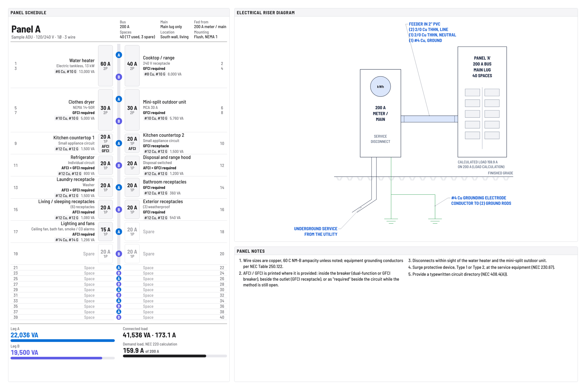

# Panel schedule kit

Part of [Oasis-Blueprints](../README.md). A separate kit beside the drawing skill: it does not need the skill, and the skill does not use it yet.

This kit draws an electrical panel schedule that reads like the panel itself. Odd circuits are on the left, even on the right, breakers sit on a centre bus, and each row is tagged Leg A or Leg B. A matching riser diagram comes with it. The output is plain HTML/SVG and prints to a 36 × 24 in sheet.



## Files

| File | What it is |
|---|---|
| `panel_ux.py` | `html(left, right, names, info, totals, slots=40, method=None)`: the panel schedule. `calc_table(rows)`: a matching table style for the load calculation. |
| `riser.py` | `riser(c)`: the riser diagram, as SVG, from a dict of ratings |
| `det.py` | The small detail-drawing kit `riser.py` uses (lines, text, leaders) |
| `DESIGN.md` | The design and styling rules. Read this before changing anything visual. |
| `example/sample_panel.json` | A sample 40-space, 200 A, 120/240 V panel |
| `example/build_example.py` | Builds `example/panel-sheet.html` from the sample |
| `fonts/` | Barlow Semi Condensed 500 and 700, embedded into the HTML. SIL Open Font License, in `fonts/OFL.txt` |

## Run the example

```
python example/build_example.py
```

This writes `example/panel-sheet.html`. Open it in a browser, or print it to PDF at 36 x 24 in with background graphics on. The script only needs Python 3; Playwright is optional, just for PDF/PNG export.

## Data

Each circuit is `[ckt, name, secondary, VA, poles, trip_amps, wire, protection]`:

```json
[9, "Kitchen countertop 1", "Small appliance circuit", 1500, 1, 20, "#12 + #12 G", "AFCI + GFCI"]
```

- **Spares:** name the circuit `"Spare"`. Unused spaces fill in automatically, up to `slots`.
- **2-pole loads:** use the lower circuit number. The load takes that row and the one below, one on each leg.
- **Leg totals:** rows alternate A, B down the panel, and a 2-pole load counts half on each leg.

Protection placement is set per circuit (see DESIGN.md §5):

```json
"method": { "9": {"AFCI": "breaker", "GFCI": "breaker"},
            "10": {"AFCI": "breaker", "GFCI": "receptacle"} }
```

Anything not listed prints as "... required" beside the circuit until the method is chosen.

## Notes

- All sizes are physical (inches and points), so the page prints true to size.
- Class names are scoped (`.pnx`, `.q-*`) so the schedule can be embedded in another page without its styles clashing.
- The sample data is generic. Use your own job data locally; don't commit client names or addresses. The
  repository's `tests/test_no_job_data.py` scans this folder on every pull request.
- The kit draws what it is given. Loads, breaker and wire sizes, protection and the load calculation come from the
  person responsible for the design; anything still open belongs on the sheet in red, not in a guessed value.

## License

MIT, like the rest of [Oasis-Blueprints](../LICENSE). The Barlow fonts are under the SIL Open Font License
([`fonts/OFL.txt`](fonts/OFL.txt)).
