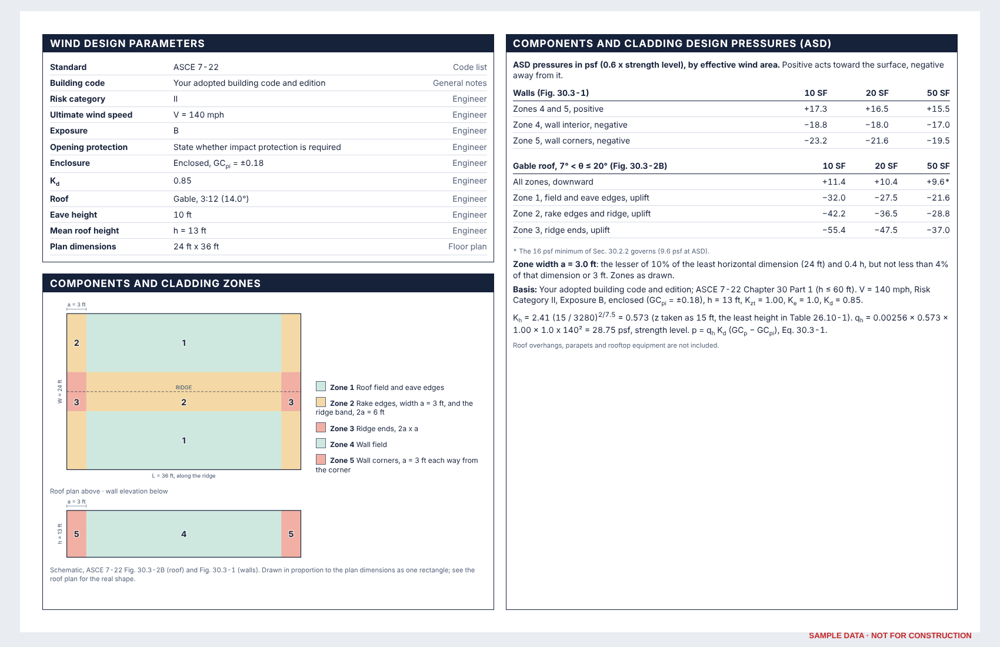

# Wind components and cladding kit

Part of [Oasis-Blueprints](../README.md). A separate kit beside the drawing skill, like the
[panel schedule kit](../panel-schedule-kit/README.md): it does not need the skill, and the skill does not use it yet.

This kit works out ASCE 7-22 components and cladding (C&C) wind pressures and puts them on a sheet as three panels:
the wind design parameters, the zone drawing (roof plan and wall elevation) and the ASD pressure table with its basis.
Everything is computed in the page from one small block of data, so the table, the drawing and the basis line always
agree, and changing an input updates all three.



## Files

| File | What it is |
|---|---|
| `cc-wind.js` | The calculation engine (`CCWind`). Walls: Fig. 30.3-1 (h ≤ 60 ft) and Fig. 30.4-1 (h > 60 ft). Roofs, h ≤ 60 ft: gable and hip, 0° to 45°, Figs. 30.3-2A to 2G. No dependencies; runs in a browser and in Node. |
| `cc-wind-diagram.js` | The zone drawings as SVG (`CCWindDiagram`): roof plan per figure, wall elevation, legend text. |
| `cc-wind-panels.js` | The three sheet panels (`CCWindKit.render(spec)`, `CCWindKit.mount(spec, elements)`). |
| `example/sample_wind.json` | A sample building, placeholders only |
| `example/build_example.py` | Builds `example/wind-sheet.html` from the sample |
| `test/cc-wind.test.js` | 97 verification values. `node test/cc-wind.test.js` |

## Run the example

```
python example/build_example.py
```

This writes `example/wind-sheet.html`, one self-contained file. Open it in a browser.

## Data

```json
{
  "code": "Your adopted building code and edition",
  "riskCategory": "II",
  "V": 140,
  "exposure": "B",
  "enclosure": "enclosed",
  "roof": { "type": "gable", "pitch": 3 },
  "eaveHeight": 10, "ridgeHeight": 16,
  "plan": { "width": 24, "length": 36 },
  "areas": [10, 20, 50],
  "sources": { "plan": "Floor plan" }
}
```

- **Roof:** `type` is `gable` or `hip`; give `pitch` (rise in 12) or `theta` (degrees). At 7° or less the low-slope
  figure is used whatever the type.
- **Height:** give `eaveHeight` and `ridgeHeight`, or `h` directly. With a slope of 10° or less, h is the eave height.
- **Optional:** `Kzt`, `elevation` (ft, sets K<sub>e</sub>) or `Ke`, `Kd`, `openingProtection`, `zoneNote`,
  `walls_only`, and `plan.note`. `sources` fills the right-hand column of the parameters table; anything not listed
  reads "Engineer".
- **`kzMinHeight`:** K<sub>h</sub> is taken at z = 15 ft for anything lower, in every exposure, as Table 26.10-1 says.
  An engineer who wants the older, more conservative 30 ft floor in Exposure B can set `"kzMinHeight": 30`; the basis
  line then says so.
- **Missing wind speed, exposure, height or plan:** the panels print a red open item and no pressures. The kit does
  not fill in a wind speed.

## Use it in a page

```html
<script src="cc-wind.js"></script><script src="cc-wind-diagram.js"></script><script src="cc-wind-panels.js"></script>
<script>
  CCWindKit.mount(spec, { parameters: el1, zones: el2, pressures: el3 });   // call again after spec changes
</script>
```

`CCWindKit.render(spec)` returns the three HTML strings and the scoped stylesheet instead, for a build step.
`CCWind.walls({...})` and `CCWind.roof({...})` return the numbers alone: GC<sub>p</sub>, strength and ASD pressure per
zone, zone widths, the figure used, and whether the 16 psf minimum governed.

## Method

- K<sub>h</sub> = 2.41 (z / z<sub>g</sub>)<sup>2/α</sup>, z not less than 15 ft (Table 26.10-1). K<sub>e</sub> = e<sup>−0.0000362 z<sub>e</sub></sup>.
- q<sub>h</sub> = 0.00256 K<sub>h</sub> K<sub>zt</sub> K<sub>e</sub> V² (Eq. 26.10-1; K<sub>d</sub> is not in q).
- h ≤ 60 ft: p = q<sub>h</sub> K<sub>d</sub> [(GC<sub>p</sub>) − (GC<sub>pi</sub>)], Eq. 30.3-1. Walls reduced 10% when the roof slope is 10° or less.
- h > 60 ft, walls: Eq. 30.4-1, positive pressure with q<sub>z</sub>, negative and internal with q<sub>h</sub>.
- Not less than 16 psf in either direction, at strength level (Sec. 30.2.2), then ASD = 0.6 × strength.
- Zone width a: lesser of 10% of the least horizontal dimension and 0.4 h, not less than 4% of it or 3 ft. The
  low-slope roof figure is laid out from h (0.6 h edge, 0.6 h × 0.2 h corners, Zone 1′ beyond 1.2 h).

## What is confirmed and what is not

The GC<sub>p</sub> lines were checked against the equations in the ASCE 7-22 commentary (Tables C30.3-1 to C30.3-8)
wherever those could be found. Four could not be confirmed from a second source and are marked `'F'` in `cc-wind.js`:
Fig. 30.3-2D Zone 3, Fig. 30.3-2E Zones 2 and 3, and Fig. 30.3-2F Zone 1. Their values at 10 SF agree with published
summaries; the slope beyond 10 SF is the open part. When one of them is used, the pressure panel prints a red check
note. The gable and hip zone layouts are drawn from a reading of the figures. Check both against the printed standard.

## Notes

- Not covered: roof overhangs, parapets, monoslope roofs over 3°, open buildings, roof zones above 60 ft, rooftop
  equipment, tornado loads.
- The drawing is one rectangle in proportion to the plan dimensions. It shows where the zones are, not the building.
- Class names are scoped (`.ccw`, `.ccz`) so the panels can be embedded in another page.
- The sample data is generic. Use your own job data locally; `tests/test_no_job_data.py` scans this folder.
- The kit calculates what it is given. Wind speed, exposure, risk category, enclosure and the effective wind areas
  come from the engineer, who checks the result before the sheet is issued.

## License

MIT, like the rest of [Oasis-Blueprints](../LICENSE).
